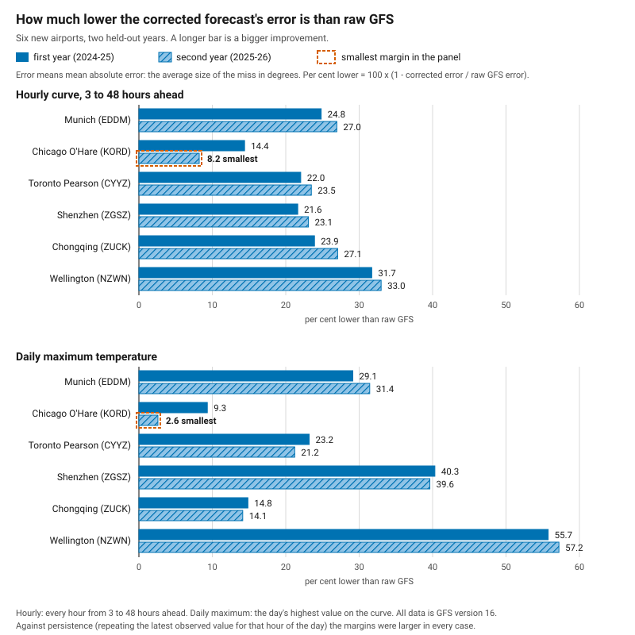
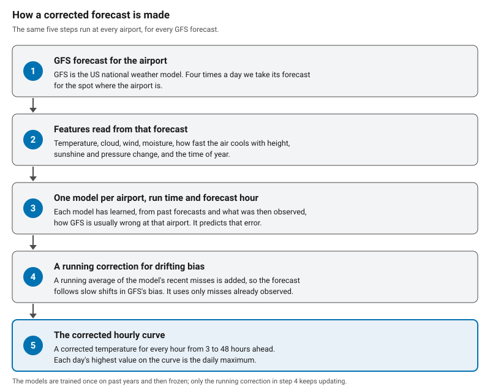
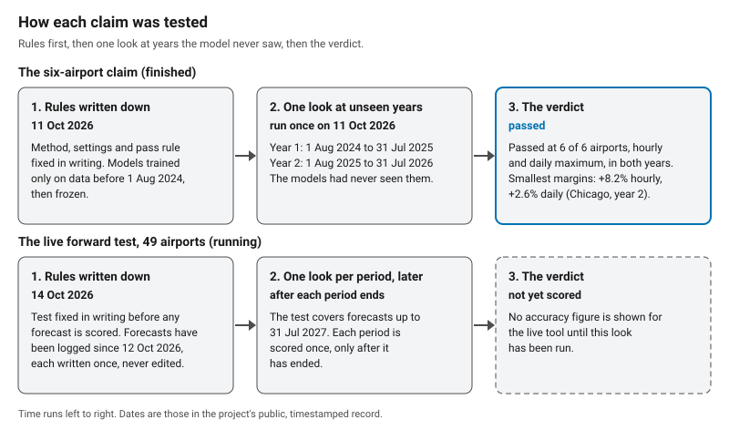
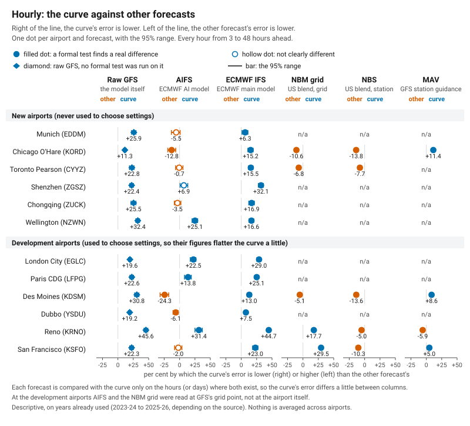

# MLwx

**Learning where a weather model keeps going wrong at an airport, and correcting it.**

MLwx corrects the temperature forecasts of GFS, the US National Weather Service's
global weather model, at airports. A live version runs at 49 airports:
https://zadams03.github.io/MLwx-live/

> **This is a research project with a public live tool. It is not an operational
> forecast, and it must not be used for safety-critical decisions.**



*The corrected forecast's error is lower than raw GFS at all six new airports, in both
test years, for the hourly curve and for the daily maximum. The smallest gain is
marked in each panel.*

## The idea in plain words

GFS is the US National Weather Service's global weather model. At any one airport it
tends to make the same small temperature error repeatedly. That error is called its
**bias**. MLwx learns that error from past forecasts and past observations, then
removes it from new forecasts.

The idea is not new. Weather services have used it for decades, under the name Model
Output Statistics. This project asks how far a careful, plain version of it goes:

- Does it work at airports on different continents, with the same recipe at each?
- Does it still work on years the model never saw?
- How does it compare with other forecasts?

Four terms are used throughout:

- **Forecast hour (lead).** How many hours after a forecast starts a value is for.
- **MAE (mean absolute error).** The average size of the miss, in degrees Celsius.
  Lower is better.
- **Raw GFS.** GFS's own temperature forecast, changed only to allow for the airport's
  height above the model's own ground level.
- **Held-out year.** A year of data kept out of everything used to build the model, so
  that it makes a fair test. A test is **pre-registered** when its rules are written
  down, in the public record, before anyone looks at its result.

## Headline results

### The hourly curve and the daily maximum, at six new airports

The project's main product is a corrected temperature for every hour from 3 to 48
hours ahead, from every GFS run, and the highest value of each day. It was tested at
six airports that were never used to choose any setting. They were drawn at random,
by a rule written down in advance, from airports with enough data: Munich (EDDM),
Chicago O'Hare (KORD), Toronto Pearson (CYYZ), Shenzhen (ZGSZ), Chongqing (ZUCK) and
Wellington (NZWN).

The models were trained only on data from before 1 August 2024, then frozen. They were
then judged once, on two held-out years: 1 August 2024 to 31 July 2025, and 1 August
2025 to 31 July 2026. In each year, at each airport, the corrected forecast's MAE had
to be lower than both raw GFS and persistence (which repeats the latest observation
for that hour of the day).

- **It passed at 6 of 6 airports, for the hourly curve and for the daily maximum, in
  both years.**
- **The smallest margin is at Chicago O'Hare in the second year, against raw GFS: the
  error is 8.2% lower for the hourly curve and 2.6% lower for the daily maximum.**
- Across all airports and both years, the hourly curve's error is 8.2% to 33.0% lower
  than raw GFS, and the daily maximum's is 2.6% to 57.2% lower. Against persistence the
  margins were larger in every case.
- Almost all of the gain comes from the models trained on past years. The running
  correction for drifting bias helps when GFS's bias shifts, and is roughly neutral
  otherwise. This is a description, not part of the test.

### The earlier results, at one hour a day

Before the hourly curve, the project corrected GFS at one hour a day, local solar noon,
at five airports: London City (EGLC), Paris Charles de Gaulle (LFPG), Des Moines
(KDSM), Dubbo (YSDU) and Reno (KRNO). Three methods were tried, each judged once on a
held-out year.

- The simplest method passed at four airports and **failed at Reno**. That failure is
  reported, and it still stands.
- The best method added more inputs from GFS. In its one held-out year, 1 August 2024
  to 31 July 2025, it lowered the MAE against raw GFS at all five airports, by 12.2%
  (Paris) to 21.0% (Reno). Every 95% range lies above zero. A 95% range shows how much
  a result could move by chance, from one day to the next, within that year.
- San Francisco (KSFO) also passed, on two pre-registered looks. Its result is for a
  grid point that is partly over the sea (37.5% of its weight), and its check against
  another data source failed for a known reason. It is not directly comparable with the
  five airports above.

Read these results with the caveats that go with them. They come from one held-out year,
judged once. The selected inputs were chosen without looking at that year, but the plain
five-input version of the method had already been scored on it, for description only.
The margins are for a different year from the margins of the earlier methods, so the two
sets must not be set side by side. The gain over the plain five-input version is small
at Des Moines (1.94%), and Reno's gain over it (10.72%) was not predicted in advance. The
95% ranges describe luck within one year, not change from year to year, and the airports
share each year's weather, so the ranges are not independent. [RESULTS.md](RESULTS.md)
has the full tables and every caveat.

## How it works



*The five steps, at every airport.*

- **The target.** For each GFS run and each forecast hour, the models learn the error:
  what was observed, minus what GFS forecast. The corrected forecast is GFS plus the
  predicted error.
- **The learning tool.** LightGBM, a standard method for learning from tables of numbers.
- **The recipe is the same at every airport.** Nothing is tuned for a single airport.
- **Missing data is dropped and counted, never filled in.**
- **Observations.** The truth is each airport's routine hourly weather report, taken
  from the Iowa Environmental Mesonet.

At one hour a day, the target was the temperature at the hour closest to local solar
noon, with daylight saving ignored so that the hour stays fixed all year.

## How the results were kept honest

- **The rules come first.** The pass bar is written down before any held-out data is
  opened, and it is not changed afterwards to fit the result.
- **One look.** Each method looks at each held-out year once.
- **Time order only.** Data is split by date, never at random, so a model never sees
  information from the future it is judged on. Code guards refuse rows from held-out or
  future years.
- **Choices and claims are kept apart.** Choices about how the product is built are
  made on other data, by testing on later years in time order. They are never quoted as
  results.
- **New airports are drawn by a fixed rule.** The six new airports were drawn at random
  by a rule written down before any check was run.
- **A live forward test, locked before any of it is scored.** The live tool's forecasts
  are logged once and never edited, and their test was pre-registered.
- **Failures are reported.** The simplest method's failure at Reno is part of the record.
- **A public, timestamped record.** [SPEC.md](SPEC.md) holds the rules.
  [DECISIONS.md](DECISIONS.md) holds every decision and finding, in the order they were
  made, and its [archive](DECISIONS-archive.md) holds the settled ones, word for word.
  Git's history records when each file was committed. For the six-airport claim, the
  rules were committed hours before the look was run. Anyone can audit it.



*How each claim was tested. The live test has not been scored.*

## How it compares with other forecasts

The curve was also compared with six other sources, on years that had already been
used. This is descriptive: it makes no claim, and it uses those years up, so they
cannot serve again as a fresh test of those forecasts at those airports. A **formal
test** here is a statistical test of whether two forecasts' errors differ by more than
chance allows.



*Hourly, every airport where the other forecast exists. Right of the line the curve's
error is lower. At the six development airports, AIFS and the NBM grid were read at
GFS's grid point, not at the airport. These airports were also used to choose settings,
so their figures flatter the curve a little.*

Where the curve leads, and where it trails:

- **Raw GFS.** The curve's error is lower at every airport. At the six new airports it
  is 11% (Chicago) to 32% (Wellington) lower for the hourly curve, and 6% (Chicago) to
  56% (Wellington) lower for the daily maximum.
- **ECMWF IFS**, the European weather centre's main model. The curve is better at 12 of 12
  airports, hourly and for the daily maximum.
- **AIFS**, the same centre's machine-learning model. Hourly, the curve is better at 4
  of 12 airports (Wellington, London City, Paris, Reno), worse at 3 (Chicago, Des Moines,
  Dubbo) and not clearly different at the other 5. For the daily maximum the curve is
  better at 9 of 12, but AIFS's maximum is the highest of its 6-hourly values. Read at
  the same steps, the curve's maximum is worse than AIFS at 6 of 12.
- **The NBM grid**, the US National Blend of Models on its own grid. Hourly, the curve is
  better at 2 of 5 airports (Reno, San Francisco) and worse at 3 (Chicago, Toronto, Des
  Moines). For the daily maximum it is better at 2 of 5 (Toronto, San Francisco).
- **NBS**, the Blend's forecast for the weather station itself. **Hourly, the curve is
  worse at all 5 airports it covers**, so local station forecasts hold information the
  curve does not use. For the daily maximum no test separates them at any of the 5.
- **MAV**, GFS's own statistical station forecast. Hourly, the curve is better at 3 of 4
  airports (Chicago, Des Moines, San Francisco) and worse at Reno. For the daily maximum
  it is better at 4 of 4.

For the daily maximum, no formal test finds the curve worse than any of these forecasts at
any airport. An earlier comparison, at one hour a day, set the best one-hour method against
the US weather service's station forecasts (MOS) and the National Blend of Models. Against
the Blend the outcome was mixed: the method's MAE was lower in 1 of 4 comparisons of an
airport and a year. [RESULTS.md](RESULTS.md) has the daily-maximum figure and the details.

## The live tool

Version 1 of the live tool applies the same method to every new GFS run at 49 airports:
the 12 airports used in the project's tests and 37 more. For each run it publishes a
corrected hourly curve out to 48 hours and each local day's highest value. It has been
doing this since 12 October 2026, and at all 49 airports since 13 October. The page is
https://zadams03.github.io/MLwx-live/.

- It runs in its own public repository, [zadams03/MLwx-live](https://github.com/zadams03/MLwx-live).
  It checks for new GFS runs twice an hour, and fills in any run from the past 24 hours
  that it missed.
- Every forecast is written once to a log that is never edited. The log's history shows
  what was issued, and when.
- The models are frozen. The live tool does not retrain.
- **No accuracy figure is shown for the live tool, and none has been computed.** Its
  forecasts are under a pre-registered test, which will be scored once, after each of its
  periods has ended. The test runs to 31 July 2027.
- The 2026-27 forward test of the one-hour models is also pre-registered, with its
  models frozen. It has not been scored either.

## Limitations

- **One test year at a time.** Each method rests on one held-out year per airport (two
  looks at San Francisco), and all of those years have now been used. A fresh test needs
  a new airport or a year that has not happened yet.
- **GFS version 16 only.** All the data is from version 16. When GFS moves to version 17,
  the models will not be retrained, and the page will mark those forecasts as not
  validated.
- **Sea in the grid box.** Toronto, Shenzhen and Wellington have sea inside the GFS grid
  box around the airport.
- **Hourly and daily-maximum errors are not comparable with the one-hour results.**
- **Development airports flatter the method a little.** They were used to choose
  settings.
- **The daily maximum tends to read a little low.** At the six new airports its average
  error is +0.12 (Toronto) to +0.25 (Shenzhen) degrees C, which means the real maximum
  was slightly warmer than shown.
- **Rounded observations.** Eight of the 12 test airports report whole degrees, so even
  a perfect forecast would show an MAE of about 0.25 degrees C against them.
- **The comparisons use years that are already spent.**

## What comes next

The owner has set this order for the longer-term plan. Whichever comes first, a GFS
version 17 announcement goes ahead of everything else: handling it in the live tool, and
preparing the scoring of the forward test.

1. Start saving the German weather service's own station forecasts (MOSMIX), so that a
   later comparison is possible.
2. One session for three small items: finish two remaining checks of the live tool's
   code; compare AIFS and the NBM grid at the airports' own positions, not at GFS's grid
   point; and test one question, whether the curve's correction for an hour predicts how
   GFS revises that hour in its next run.
3. Forecasts as ranges with stated odds (probabilistic forecasts), starting on GFS. Whether
   to pre-register a test of them on 2026-27 is decided early, before any 2026-27 value
   has been scored.
4. Correcting other weather models on their own, starting with AIFS, then blending the
   corrected models. Whether raw AIFS should instead go straight into the GFS model as an
   input is decided when that work is planned.
5. Google's WeatherNext stays on hold until access is granted.

The 2026-27 forward test and the live test are scored only when their periods end.

## Repository map

| group | entry | what it is |
|---|---|---|
| Start here | `README.md` | This file. |
| | [RESULTS.md](RESULTS.md) | The results in full, in plain language, with where each number comes from. |
| | [figures/](figures/) | The figures. The ones in this file are in `figures/readme/`, drawn by `scripts/session127_readme_figures.py`. The older ones are drawn by `scripts/session98b_figures.py` and `scripts/session108_figures.py`. `figures/analysis/` holds the figures of ANALYSIS.md. |
| The research record | [SPEC.md](SPEC.md) | The source of truth for how the project should work. |
| | [DECISIONS.md](DECISIONS.md) | The live log of decisions and findings. Settled entries move to the archive. |
| | [DECISIONS-archive.md](DECISIONS-archive.md) | Settled entries moved out of DECISIONS.md word for word. |
| | [STATUS.md](STATUS.md) | A snapshot of where the project is now. |
| | [ANALYSIS.md](ANALYSIS.md) | Descriptive analysis on used data: a field guide, comparisons with other forecasts and ideas for later. Never a source of rules or claims. |
| Code and data | [scripts/](scripts/README.md) | The code, named by the session that wrote it. |
| | [src/mlwx/](src/mlwx/) | The live tool's code, a Python package. |
| | [deploy/mlwx-live/](deploy/mlwx-live/) | The template for the MLwx-live repository's files and workflow. |
| | [tests/](tests/README.md) | Offline checks of the leakage guards, the archive tool and recorded figures. |
| | [data/](data/README.md) | Raw pulls, built tables, frozen models and rebuild checks. |
| | [requirements.txt](requirements.txt) | The pinned Python packages, with setup notes. |
| | [.github/](.github/) | The GitHub Actions workflow for the GRIB pull. |
| | `.gitignore` | Files kept out of the repository. |
| How the work was run | [docs/](docs/README.md) | Session prompts, commit messages and the planning guide. |
| | [notes/](notes/README.md) | Each session's saved output, and audit reports. |
| | [CLAUDE.md](CLAUDE.md) | The standing rules for the AI coding sessions. |
| | [LICENSE](LICENSE) | The MIT licence for the code. |

The record files sit at the root, and the scripts are named by session number, because
the scripts read the record files there and the record cites the scripts by path.

## Reproducing

This section lists what can be checked by reading `requirements.txt`, the scripts and
SPEC.md. The one exception is the libomp check below, which was run in a session of its
own.

- **Python setup.** Python 3.12.2 on macOS (arm64). From the repo root:

  ```
  python3 -m venv .venv
  .venv/bin/python -m pip install -r requirements.txt
  ```

  Versions are pinned in `requirements.txt` (for example lightgbm 4.7.0 and numpy 2.5.2).
  The `eccodes` package brings the ecCodes GRIB library with it.
- **libomp.** LightGBM on macOS needs the OpenMP library `libomp.dylib`. Run
  `brew install libomp`. With Homebrew's libomp 23.1.3 and the older scripts' loader
  workaround switched off, the cross-validation script reproduced the best method's six
  recorded MAEs exactly, and its London City scores were byte-equal to the committed file.
  Older scripts keep the workaround, which points at scikit-learn's copy of the library.
  It is harmless when Homebrew's libomp is present (see `requirements.txt`).
- **Run scripts** with `.venv/bin/python scripts/<script>.py`, not a bare `python`,
  because the system Python has no LightGBM.
- **Small raw pulls are committed** under `data/raw/`, each with a `.meta.txt` beside it
  that gives the pull date and the exact query.
- **The bulk GRIB cache is not committed.** It is the gitignored folder `data/raw/grib`
  (about 39 GB), now on an external drive. Only finished scripts from sessions 37 to 89
  read it, so they need the drive to re-run. The committed pull manifests under
  `data/raw/diagnostics/` (for example `session37/session37_pull_manifest.csv` and
  `session76/session76_pull_manifest.csv`) give the exact URL and byte range of each
  file. The pull scripts (`session37_grib_pull.py`, `session40_grib_pull.py`, and the
  feature pulls such as `session49_upper_air_pull.py`) fetch single messages from the
  public bucket `noaa-gfs-bdp-pds` by byte range.
- **The hourly curve's data lives outside the repo:** the Release files and the
  development table. The pull read GFS files by byte range on GitHub Actions: 65 months,
  195,600 files and 1,932,528 messages, published as Release files. A 13-check verifier
  ran on each month before it was published, except the first month (2022-01), which was
  pulled before the verifier existed and was checked afterwards. All 65 months were then
  downloaded and checked again. See [data/README.md](data/README.md).
- **Inputs are checked by SHA-256**, a file fingerprint, and repeat runs give
  byte-for-byte equal output.
- **Not verifiable from the repo:** the full run order of all the scripts is spread across
  DECISIONS.md and is not written in one place, and no session has re-fetched the cache
  from scratch. [scripts/README.md](scripts/README.md) lists the scripts behind each
  headline result.
- **Frozen scripts** are never edited; the full list is in
  [scripts/README.md](scripts/README.md). Some write to fixed, already-committed output
  files, so any re-run must happen in a clean clone.

## How this was built

The owner planned the work, made every decision, wrote every session prompt and reviewed
every change. The code was written by Claude Code (Anthropic's AI coding tool) under the
standing rules in [CLAUDE.md](CLAUDE.md), one scoped session at a time. Every change was
reviewed and committed by hand. The decision record in DECISIONS.md shows the reasoning
behind each step. The full working record is in [docs/](docs/README.md) (what each session
was asked to do) and [notes/](notes/README.md) (what each session actually printed).

## Where these numbers come from

Each number or claim above is recorded in the entry or file named here. "F" and "D"
numbers are entries in [DECISIONS.md](DECISIONS.md) or its
[archive](DECISIONS-archive.md); "SPEC" is [SPEC.md](SPEC.md).

| number or claim in this file | where it is recorded |
|---|---|
| Six new airports drawn at random by a fixed rule, with their strata | D82.7 |
| Models trained only on data before 1 August 2024, then frozen | D100.3(c), SPEC 9.5 |
| The two held-out years, 1 Aug 2024 to 31 Jul 2025 and 1 Aug 2025 to 31 Jul 2026 | D100.4 |
| The pass bar: lower MAE than raw GFS and than persistence, in both years | D100.5, SPEC 9.5 |
| Passed at 6 of 6 airports, both outputs, both years | F150 (title and F150.1), SPEC 9.5, `data/processed/session107_claim_verdicts.csv` |
| Smallest margins +8.2% hourly and +2.6% daily maximum (Chicago, second year; 8.216 and 2.589) | F150, SPEC 9.5 |
| Margins over raw GFS from 8.2% to 33.0% hourly and from 2.6% to 57.2% daily (smallest 8.22 and 2.59, largest 32.99 and 57.21) | F150.2 |
| Margins over persistence larger in every case | F150.2 |
| Most of the gain from the trained models; the running correction helps when bias shifts, neutral otherwise (description only) | D102.2, D100.8, SPEC 9.5 |
| The figure of the gain over raw GFS (24 values) | F150.2; drawn by `scripts/session127_readme_figures.py` from `data/processed/session107_claim_verdicts.csv` |
| The timeline's dates: rules 11 Oct 2026, look 11 Oct 2026, live test rules 14 Oct 2026, first live cycle 12 Oct 2026, test to 31 Jul 2027 | D100 (heading), F150.4, D105 (heading), D105.5(d), D105.5(e) |
| The rules were committed before the look was run | Git history: commit `edb51d4`, 11 Oct 2026 19:07 (+0100, which is 18:07 UTC); the look ran from 20:45 UTC (F150.4) |
| The simplest method passed at four airports and failed at Reno | F16, F30, F47, F64, F82; RESULTS.md |
| The best one-hour method: 12.2% (Paris) to 21.0% (Reno) lower MAE than raw GFS; every 95% range above zero | F109, F125.6 |
| The held-out year of the best method, 1 Aug 2024 to 31 Jul 2025 | D51, F109 |
| The caveats on F109's result: one year; plain five-input version already scored on it; a different year from the earlier methods; Des Moines 1.94%; Reno 10.72% | D59.3 (a) to (e), F109 |
| San Francisco: two looks, 37.5% sea weight, failed check, not directly comparable | F119, D71.5, F117.3, D69 |
| The 95% ranges describe one year, are not independent, and are descriptive | F125.9, D75.2 |
| The comparisons: AIFS, NBM grid, NBS, MAV and ECMWF IFS counts (formal tests, hourly and daily maximum) | ANALYSIS.md Part 1, item 1 and item 4 (Tables 2a and 2b); F157.3, F157.4, F160.9 |
| The curve's error 11% (Chicago) to 32% (Wellington) lower hourly than raw GFS, 6% (Chicago) to 56% (Wellington) for the daily maximum | ANALYSIS.md Part 1, item 1 |
| AIFS's maximum is the highest of its 6-hourly values; at those steps the curve is worse at 6 of 12 | ANALYSIS.md Part 1, item 4 ("Read with care"); F157.7(2) |
| AIFS and the NBM grid read at GFS's grid point at the development airports | D108.3, F157.7(3) |
| Comparison years are used up for those forecasts at those airports | D107.3 |
| The earlier one-hour comparison against the NBM: mixed, 1 of 4 | F127, D78.1 |
| The figures of the comparisons (50 dots each) | ANALYSIS.md Tables 2a and 2b; `data/processed/session114_comparisons/` and `data/processed/session112_analysis/`; drawn by `scripts/session127_readme_figures.py` |
| The live tool: 49 airports (12 plus 37), the hourly curve to 48 hours, the daily maximum | D103.2, D103.4, D105.5(d), F153.6 |
| Running since 12 October 2026, at 49 airports since 13 October | D105.2, D105.3 |
| It checks twice an hour and fills in missed runs from the past 24 hours | D103.9, D118.2 |
| The log is written once and never edited; the models are frozen | D103.8, D103.5 |
| No accuracy figure is computed or shown for the live tool | D103.2, D105.6 |
| The live test is pre-registered, scored after each period ends, to 31 July 2027 | D105.5 |
| The 2026-27 forward test is pre-registered, with frozen models, not scored | D73, F122, D73.8 |
| GFS version 16 only; version 17 not retrained and marked not validated | D100.10, D103.10 |
| Sea in the grid box at Toronto, Shenzhen and Wellington | F132.3, D100.10 |
| Hourly and daily-maximum errors are not comparable with one-hour results | D100.10, SPEC 9.6 |
| The daily maximum's mean error +0.12 (Toronto) to +0.25 (Shenzhen) degrees C | ANALYSIS.md Part 1, item 1 and item 3 |
| Eight of 12 airports report whole degrees; the 0.25 degree floor | ANALYSIS.md Part 1, item 6 |
| The order of the longer-term plan | D121.2, D121.3 |
| The rules of the method: time-split only, bar fixed first, one look, missing data dropped and counted, same recipe everywhere, choices apart from claims | SPEC 2.1a, 2.2, 2.4, 2.5, 5.0, 5.3 |
| The five steps in the diagram, and the target | SPEC 9.1, 9.3, 4.2 |
| The one-hour target at local solar noon, daylight saving ignored | SPEC 4.1 |
| The data pull: 65 months, 195,600 files, 1,932,528 messages, a 13-check verifier | D84.4, F134, D87, F137 |
| The libomp check, with Homebrew libomp 23.1.3 | F140 |
| The GRIB cache, 39 GB, on an external drive | D102.3 |
| Frozen scripts are never edited | D62.3(a), D62.3, D62.6 |
| Stage names behind "what comes next" | D121.2, D72.2(b), D107.4 |

## Data credits and terms

The data is not covered by the code licence. It stays under its sources'
terms. The terms below were read from each source's own page on
2026-09-29 (F126.3), except NBM's, which were read on 2026-10-07 (D91.5).
The terms of the sources added in session 124 (ECMWF IFS and AIFS, NBS,
the CLI reports and GHCN-Daily), and MAV's own, were read on 2026-11-01
(D118.12).

- **Open-Meteo** (Previous Runs API, `previous-runs-api.open-meteo.com`).
  Supplied past GFS forecasts for the minimal method. Data offered under
  CC BY 4.0: give credit, link to the licence and say if changes were
  made. Terms page: https://open-meteo.com/en/terms. Licence page:
  https://open-meteo.com/en/licence. The free API is for non-commercial
  use only, under 10,000 calls a day. The raw JSON pulls under
  `data/raw/` are Open-Meteo's data unchanged. The processed files built
  from them (under `data/processed/`) are derived, changed values.
  Weather data by [Open-Meteo.com](https://open-meteo.com/).
- **Iowa Environmental Mesonet (IEM), Iowa State University** (ASOS
  observation download, `mesonet.agron.iastate.edu`). Supplied the
  hourly airport observations that are the truth data. Its disclaimer
  page says its materials are in the public domain and may be used for
  any lawful purpose, and that credit to the IEM would be appreciated.
  Page: https://mesonet.agron.iastate.edu/disclaimer.php. The committed
  observations also include the hourly reports of 45 further airports,
  pulled for stage C (F132.4).
- **NOAA / NCEP GFS** (GRIB2 files from the NOAA Open Data Dissemination
  program, hosted on AWS in the bucket `noaa-gfs-bdp-pds`). Supplied the
  GRIB forecasts for the richer and selected methods. The AWS registry
  page says the data is open and may be used as desired, that NOAA
  requests credit for unaltered data, that you may not state or imply
  NOAA endorses you, and that modified data may not be presented as
  original. Page: https://registry.opendata.aws/noaa-gfs-bdp-pds/. This
  repo's processed files are derived values, and the few small `.grib2`
  samples under `data/raw/diagnostics/` are NOAA data.
- **NOAA GFS point values for stage C** (published as files of this
  repository's GitHub Release `stagec-grib-pull-v1`, not committed). The
  values at the four grid points around each airport, read from the GFS
  GRIB2 files above and kept exactly as decoded (D83.5(c), F137). They
  are derived from NOAA GFS, under the GFS terms above.
- **NOAA National Blend of Models (NBM)** (read from NOAA's NBM archive on
  AWS, bucket `noaa-nbm-grib2-pds`). Supplied the 2 m temperature values
  for the comparison on the spent years, committed in
  `data/processed/session85_competitor_points.csv` (F127.3). The NBM
  grid values at the four grid points around KDSM, KRNO, KSFO, KORD and
  CYYZ, for the descriptive comparisons on spent years, are committed in
  `data/processed/session113/` (`nbm_*.csv.gz`, with their manifest and
  grid positions; D107.4). The AWS
  registry page (https://registry.opendata.aws/noaa-nbm) says NOAA
  requests attribution for unaltered NOAA data, that it is not permitted
  to state or imply endorsement by or affiliation with NOAA, and that
  modified NOAA data may not be presented as original, unaltered NOAA
  data (D91.5).
- **NWS GFS MOS (MAV), through the IEM archive** (`api/1/mos.json`).
  Supplied the MOS values at DSM for the same comparison. The 365 raw
  responses are committed unchanged in `data/raw/iem_mos/session85/`
  (F127.3). MAV values at KDSM, KRNO, KSFO and KORD, for the descriptive
  comparisons on spent years, are committed in
  `data/processed/session113/` (`mav_*.csv.gz`, with the queries;
  D107.4), read through IEM's `cgi-bin/request/mos.py`. The IEM's
  disclaimer (above) says its materials are in the public domain. The
  NWS's own page says its information is in the public domain and may be
  used for any lawful purpose, as long as you do not claim it as your
  own, imply endorsement by or affiliation with NOAA or the NWS, or
  change it and present it as official government material. Page:
  https://www.weather.gov/disclaimer. No credit is required; the IEM
  would appreciate credit to the Iowa Environmental Mesonet of Iowa
  State University.
- **ECMWF IFS and AIFS open data** (the AWS copy of ECMWF's open data,
  bucket `ecmwf-forecasts`). Supplied ECMWF's 2 m temperature forecasts,
  and its maximum 2 m temperature field, at the four grid points around
  each of the 12 airports of D103.4, for the descriptive comparisons on
  spent years (`ANALYSIS.md`). Committed in `data/processed/session113/`
  (`ifs_*.csv.gz` and `aifs_*.csv.gz`, with their manifests, grid
  positions and terrain files; D107.4). The values are decoded from
  ECMWF's GRIB2 files and kept at full precision in kelvin; the only
  change is that just these points and fields are kept, as CSV files.
  The data is published under the Creative Commons Attribution 4.0
  licence (CC BY 4.0) and ECMWF's Terms of Use: it may be shared and
  used, also commercially, if ECMWF is credited as the source, the
  licence is linked and any changes are stated. ECMWF gives no warranty
  and accepts no liability for the data. Pages:
  https://www.ecmwf.int/en/forecasts/datasets/open-data,
  https://www.ecmwf.int/en/forecasts/datasets/aifs-machine-learning-data
  and the terms, https://apps.ecmwf.int/datasets/licences/general/.
  Credit, in the wording ECMWF asks for: Copyright "© 2023-2026 European
  Centre for Medium-Range Weather Forecasts (ECMWF)". Source:
  www.ecmwf.int. This data is published under a Creative Commons
  Attribution 4.0 International (CC BY 4.0) licence,
  https://creativecommons.org/licenses/by/4.0/. ECMWF does not accept
  any liability whatsoever for any error or omission in the data, their
  availability, or for any loss or damage arising from their use. The
  results in `ANALYSIS.md` on these values are based on data and
  products of the European Centre for Medium-Range Weather Forecasts
  (ECMWF).
- **NWS NBM station text (NBS), through the IEM archive**
  (`cgi-bin/request/mos.py`, model NBS). Supplied the NBS values at
  KDSM, KRNO, KSFO, KORD and CYYZ for the descriptive comparisons on
  spent years. Committed in `data/processed/session113/`
  (`nbs_*.csv.gz`, with the queries; D107.4), as issued in whole degrees
  F and also converted exactly to degrees C. Terms as for MAV above: the
  IEM's materials and the NWS's information are in the public domain,
  under the NWS's conditions (https://www.weather.gov/disclaimer,
  https://mesonet.agron.iastate.edu/disclaimer.php). No credit is
  required; the IEM would appreciate credit to the Iowa Environmental
  Mesonet of Iowa State University.
- **NWS daily climate reports (CLI), through the IEM archive**
  (`json/cli.py`). Supplied the official daily maximum at KDSM, KRNO,
  KSFO and KORD (D107.8). Committed in
  `data/processed/session113/official_cli.csv.gz`, with
  `official_agreement.csv` (the count of days on which CLI and
  GHCN-Daily agree). Terms as for MAV above. No credit is required; the
  IEM would appreciate credit to the Iowa Environmental Mesonet of Iowa
  State University.
- **GHCN-Daily, NOAA National Centers for Environmental Information
  (NCEI)** (Access Data Service, `www.ncei.noaa.gov/access/services/data/v1`,
  dataset `daily-summaries`, TMAX). Supplied the cross-check of the
  official daily maximum at four US stations: USW00014933 (KDSM),
  USW00023185 (KRNO), USW00023234 (KSFO) and USW00094846 (KORD)
  (D107.8). Committed in `data/processed/session113/official_ghcn.csv.gz`.
  NCEI's page sets no limit on use or sharing; it gives no warranty and
  asks users to cite the dataset. Neither page has a note on data
  exchanged under WMO Resolution 40, and all four stations are US
  stations. Pages:
  https://www.ncei.noaa.gov/metadata/geoportal/rest/metadata/item/gov.noaa.ncdc:C00861/html
  and https://www.ncei.noaa.gov/pub/data/ghcn/daily/readme.txt. Credit,
  in the form NCEI asks for: Menne, M.J., I. Durre, B. Korzeniewski, S.
  McNeill, K. Thomas, X. Yin, S. Anthony, R. Ray, R.S. Vose, B.E.
  Gleason, and T.G. Houston, 2012: Global Historical Climatology
  Network - Daily (GHCN-Daily), Version 3 (TMAX at the four stations above).
  NOAA National Climatic Data Center. doi:10.7289/V5D21VHZ, accessed
  2026-10-15. Also: Menne, M.J., I. Durre, R.S. Vose, B.E. Gleason, and
  T.G. Houston, 2012: An overview of the Global Historical Climatology
  Network-Daily Database. Journal of Atmospheric and Oceanic Technology,
  29, 897-910, doi:10.1175/JTECH-D-11-00103.1.
- **Probed only, no data committed** (F123, F124.4): DWD ICON, NOAA
  GEFS, Google WeatherNext, and Open-Meteo Single Runs. Each was checked read-only for archive depth and fields.
  Their terms were not fetched.

## Licence

The code is released under the MIT licence. See [LICENSE](LICENSE). There
is no warranty. The code and results are for research use and are not for
operational or safety-critical use. The licence does not change the terms
of the data in the data credits section.

Author: Zachary Adams.
