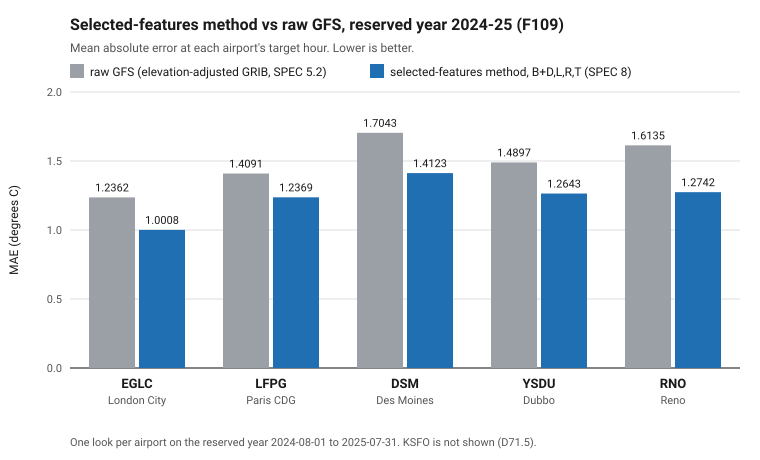
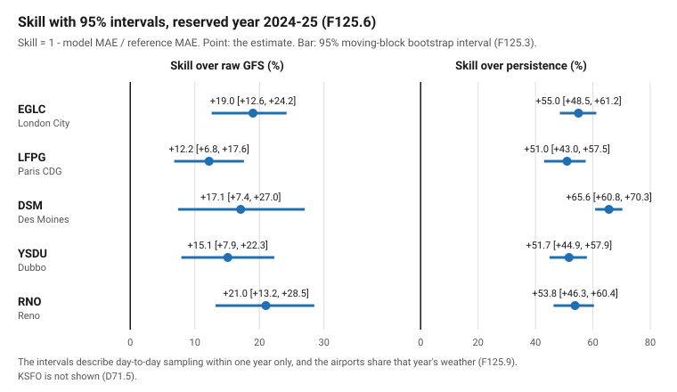
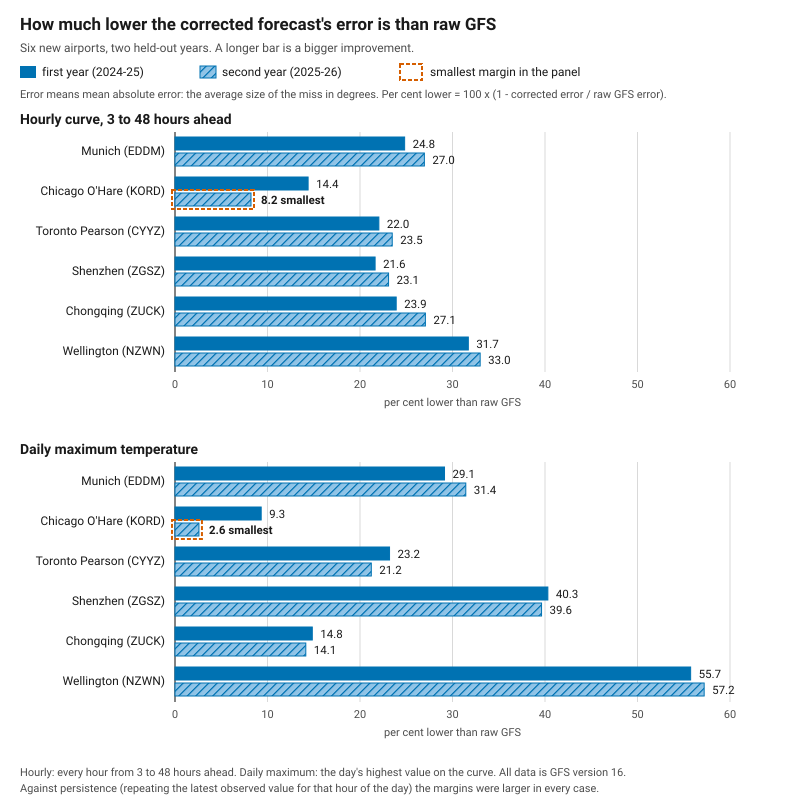
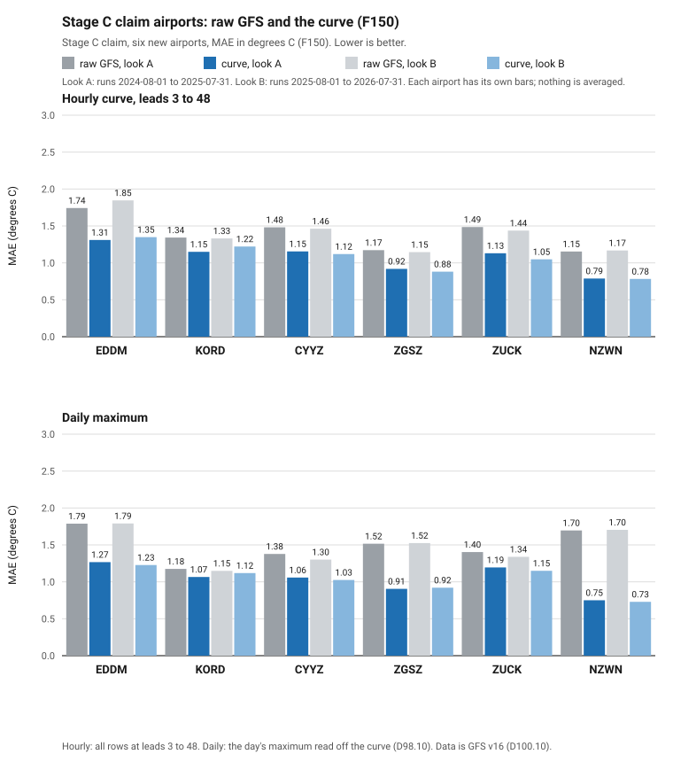
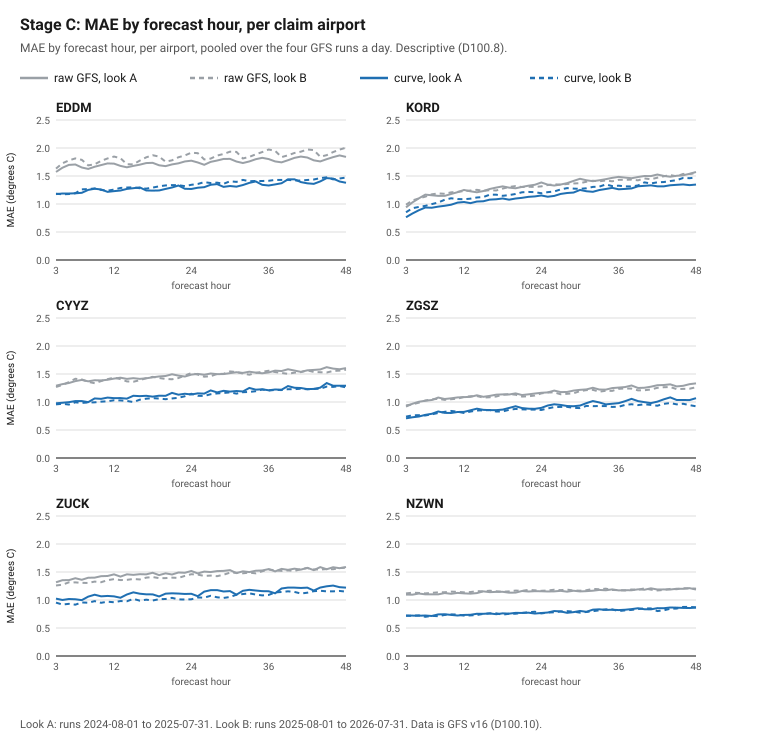
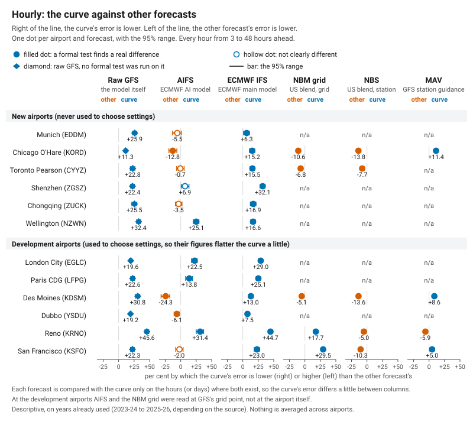
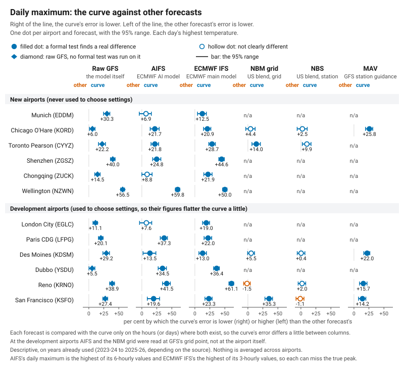
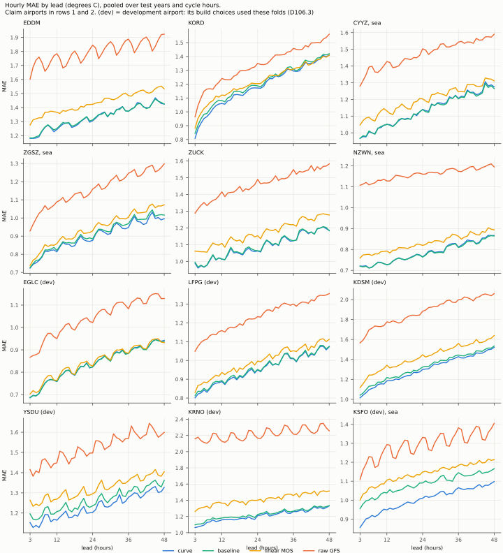

# The results, in plain language

This file gives the project's results in full, for a reader who wants the detail.
[README.md](README.md) is the short version.

Every number here is copied from the project's record: [SPEC.md](SPEC.md),
[DECISIONS.md](DECISIONS.md) and its [archive](DECISIONS-archive.md), and the result
files. Nothing is recomputed, and nothing is averaged across airports. The last
section, "Where these numbers come from", says where each number is recorded. Where
this file and SPEC.md disagree, SPEC.md is right.

**Words used here**

- **GFS** is the US National Weather Service's global weather model.
- **Bias** is an error a forecast makes repeatedly, in the same direction.
- **MAE (mean absolute error)** is the average size of the miss, in degrees Celsius.
  Lower is better.
- **Skill** is `1 - model MAE / reference MAE`, in per cent. Positive means the model
  beats the reference by that share. The text also says "lower than" for the same idea:
  "8.2% lower" means a skill of +8.2%.
- **Raw GFS** is GFS's own temperature forecast. From section 3 onward it is adjusted for
  the airport's height (a fixed correction of 7.429 degrees C per kilometre of difference
  between the model's ground and the airport). In section 2 it is Open-Meteo's served
  value, with no adjustment by this project.
- **Persistence** is the lazy guess: repeat what was last observed.
- **Held-out year.** A year of data kept out of everything used to build a model, so
  that it makes a fair test. A **sealed** year is one opened once, after the method is
  locked. A **reserved** year is one set aside in advance for a later confirmation.
- **Pre-registered.** The rules of a test are written down, in the public record, before
  anyone looks at its result.
- **Claim and build choice.** A *claim* is a stated result, such as "beats raw GFS by X%".
  It needs a held-out test, with the method, the data and the pass rule fixed in writing
  first, and one look. A *build choice* is how the product is made: which inputs, which
  settings. Build choices are made by testing on later years in time order, on data that
  is not held out for any claim, and are never quoted as results.
- **Lead** (forecast hour) is the number of hours after a forecast starts.
- **95% range.** A range that shows how much a result could move by chance within the
  test year. It comes from resampling the test days in blocks of 7 days, 10,000 times
  (a block bootstrap).

---

## 1. What the project is

Big weather models are good at the physics of weather. This project uses GFS. But at any
one place such a model tends to make the same small mistakes over and over. That
repeated, predictable error is called **bias**. This project corrects it. At each
airport it learns GFS's bias from several years of past forecasts and observations, and
then corrects new forecasts for that same learned error. The technique is called Model
Output Statistics, or MOS. It is decades old and well understood, and it is not a new
idea. What the project tests is how far a small, plain version of it travels across very
different places, and how much a richer version buys once the plain version hits a wall.

At each airport a model learns the **residual**: the observed temperature minus the
forecast temperature. It learns this from a small set of inputs, and it never sees the
future it is trying to predict.

### How a result is judged

The result is judged against two honest baselines: raw GFS, and persistence ("tomorrow
will be the same as today"). The discipline is to rehearse on one year, then open a
single sealed test year once. The pass bar is fixed in writing before any test year is
opened:

> An airport passes if its corrected forecast has a lower MAE than **both** raw GFS and
> persistence, over that airport's own test year.

The bar is qualitative. It has no numeric margin, ever, so a pass by a hair and a pass by
a mile are both passes, and the honest margin is always reported beside the verdict.
Where an airport has more than one look, it passes only if every look passes. Nothing is
pooled or averaged across airports. A later airport's result does not change an earlier
one's, and an earlier pass does not excuse a later failure.

### The story in one page

There are three methods at one hour a day, and then the hourly curve.

1. **The minimal method** (section 2): three inputs. It passes at four of five airports
   and fails at Reno. That failure is itself a finding.
2. **The richer method** (section 3): two more inputs and a different forecast source. It
   passes at all five, Reno included.
3. **The selected-features method** (section 4): four more inputs, chosen by a staged
   search. It passes at all five on a reserved year. It is the project's default recipe.
   It also passed at San Francisco (section 5), with its own framing.
4. **The hourly curve and the daily maximum** (section 7): the same recipe widened to
   every GFS run and every hour from 3 to 48 hours ahead. It passed its pre-registered
   test at six new airports, in two held-out years.

All of these results are real, and none erases another. Read together, they tell a story
about what the minimal method's ceiling was, what first addressed it, what a disciplined
search for more inputs added, and what happens when the recipe is widened.

---

## 2. The minimal method, and Reno

### 2.1 How it works

**The target.** The temperature at one fixed hour a day, chosen for each airport so that
it falls at that airport's own local solar noon. Local noon is in daylight (which catches
the daytime heating GFS tends to mishandle), it is a stable, well-observed time of day,
and it is clear of the swings at dawn and dusk. Daylight saving is deliberately ignored,
so each airport's target stays at one fixed UTC hour all year.

London City (EGLC) and Paris Charles de Gaulle (LFPG) share 12:00 UTC by deliberate
design, not by coincidence of longitude. 12:00 UTC is London's own local noon, and
Paris's local noon is closer to 11:00 UTC. The two were run at the same hour so that the
comparison between them changes only the location. Des Moines (DSM) uses 18:00 UTC, Dubbo
(YSDU) 02:00 UTC and Reno (RNO) 20:00 UTC, each its own local-solar-noon hour. So only
London City and Paris make the clean "only the location changed" comparison. Every airport
from Des Moines onward changes the location and the target hour together, so their results
answer "does the recipe travel to a different place at a comparable local time", not "does
it travel with literally nothing else changed".

**What is learned.** A gradient-boosted tree model (LightGBM, a standard method for
learning from tables of numbers) predicts the residual at that hour. The corrected forecast
is GFS's forecast plus the predicted residual. Exactly three inputs are used, deliberately
few:

```
forecast_temp_c   the GFS forecast temperature for that day at the target hour
season_sin        sin(2*pi*year_fraction(date))
season_cos        cos(2*pi*year_fraction(date))
```

There is no hour-of-day input, because the hour is fixed and so carries no information.
There is no recent-observation input, on purpose, so that the model corrects *the
forecast* and does not quietly become a persistence model in disguise.

The model settings are fixed and identical at every airport:

```
LightGBM, objective=regression_l1, n_estimators=300, learning_rate=0.05,
num_leaves=15, min_child_samples=40, random_state=42, deterministic=True,
n_jobs=1
```

Nothing is tuned per airport. Only the airport's own data and its own target hour change
from one run to the next.

**The split.** All five airports share the same fixed dates:

- **Training window: 2021-03-24 to 2025-07-31.** For rehearsal it is split into an inner
  training period (2021-03-24 to 2024-07-31) and a validation year (2024-08-01 to
  2025-07-31), so the whole method can be tried out once without touching the real test
  year.
- **Test window, sealed: 2025-08-01 to 2026-07-31.** It was opened exactly once per airport,
  after the method was locked in writing.

Splitting is always by time (train on earlier dates, test on later ones), never at random,
so the model can never see information from the future it is tested on.

**Pairing an observation to a forecast.** Each day's forecast at the target hour is paired
with the airport's nearest scheduled weather report to that hour. If no report falls within
15 minutes, that day is dropped and counted, and never filled in. The offset is small at
every airport (5 to 10 minutes), except at Paris and Dubbo, which report exactly on the hour.

**Data hygiene, the same at every airport.**

- **The archive has one shared gap**: 492 hours, from 2023-12-30 00:00 to 2024-01-19 11:00
  UTC. It is present at every airport pulled so far and always falls inside the training
  window, never inside the sealed test year. It is dropped and counted, never filled.
- **The forecast model is pinned to `gfs_global`**, the explicit NCEP GFS name, rather than
  Open-Meteo's `gfs_seamless` label. At most airports the two are identical, so the pin costs
  nothing. But at Des Moines, inside the continental United States, the two differ by up to
  12.3 degrees C on some hours, because `gfs_seamless` can silently swap in a US-only model.
  The pin is what makes "this is genuine NCEP GFS" true by construction. Des Moines shows
  why it was worth checking rather than assuming.

### 2.2 The results at five airports

**Stated plainly first: the recipe passes at four airports across three continents and two
hemispheres, unmodified, and fails at the fifth, in the way its own advance prediction said
it would.**

| airport | region | target hour (UTC) | test days | raw GFS MAE (degrees C) | corrected MAE (degrees C) | skill over raw GFS | skill over persistence | verdict |
|---|---|---|---|---|---|---|---|---|
| EGLC (London City) | Western Europe, north | 12:00 | 363 | 1.242 | 1.040 | **+16.3%** | +50.4% | **PASS** |
| LFPG (Paris CDG) | Western Europe, north | 12:00 | 363 | 1.396 | 1.208 | **+13.5%** | +47.5% | **PASS** |
| DSM (Des Moines) | North America interior, north | 18:00 | 365 | 1.815 | 1.700 | **+6.3%** | +57.5% | **PASS** |
| YSDU (Dubbo) | Australia, south | 02:00 | 347 | 1.251 | 1.210 | **+3.3%** | +54.7% | **PASS** |
| RNO (Reno) | North America mountain, north | 20:00 | 365 | 1.414 | 1.458 | **-3.1%** | +41.4% | **FAIL** |

Positive skill means the correction beats the reference. Negative means the reference
(raw GFS, at Reno) beats the correction. All five test years are the same shared twelve
months (2025-08-01 to 2026-07-31), so this is not five independent draws of weather (see
finding 5 below). Reno's raw GFS figure here (1.414) is Open-Meteo's. Section 3 describes a
separate, later method, using a different forecast source, that passes at Reno too.

**Every one of the five airports beats persistence comfortably** (41% to 58% better). The
correction is never worse than the laziest possible guess. The raw GFS half of the bar is
what decides each verdict, and it is the half that finally failed at Reno.

### 2.3 What it found

**1. Four passes across three continents and two hemispheres: the recipe travels.** The
same unmodified method (three inputs, one model, one frozen bar) passed at a small European
city airport (London City), a major European hub (Paris), a continental-interior US airport
with far larger day-to-day swings (Des Moines), and a southern-hemisphere Australian airport
with a flipped season cycle (Dubbo). Nothing was retuned or added between airports.

**2. Four distinct bias shapes: the model adapts to local structure, not a template.** The
share of the model's learning that goes to the forecast temperature differs by airport:
London City 51.8%, Paris 38.2%, Des Moines 43.4%, Dubbo 45.3%, Reno 39.1%. London City's bias
lives mostly in the temperature itself (a "warm-end" shape). Paris's lives more in the
calendar. Des Moines carries both. Dubbo's is concentrated in one local season. The same
three inputs are read differently at each place.

**3. The flipped-season result: the method works across hemispheres.** Dubbo's bias peaks in
its own local summer, in the southern hemisphere, not in the northern-calendar season that
carries the label "summer" at the other four airports. The season inputs are encoded as a
position in the calendar year, not a hard-coded "summer means June to August", so the model
correctly works out which part of the year matters for a place on the other side of the equator.

**4. The Reno failure, and why it matters: systematic against random error.** Reno's
forecast error is close to a **near-constant offset** (the station runs warmer than GFS on
about 68% of training days, against 45% to 52% at every other airport). That offset sits
under **large day-to-day scatter**, not a structured, learnable pattern. A tree model fitting
that shape looks good on the data it was trained on (an apparent improvement of 25.0%) and
adds almost nothing on new data (-3.1%). That is the textbook sign of overfitting a signal
that is mostly noise. It is not a defect in the method. It is what the method should do when
the truth is "there isn't much learnable structure here beyond a small constant".

The contrast with Des Moines is the clean statement of the finding: **Des Moines is a
hard-but-structured airport and passes; Reno is a moderate-but-mostly-random airport and
fails.** This outcome was written down in advance, before Reno's sealed year was opened, based
on the same signature already visible in Reno's rehearsal. A failure predicted correctly in
writing is stronger evidence for this reading than a failure noticed only afterwards. **The
finding stands unchanged.** Section 3 describes a later method that was built to test whether
Reno's apparent ceiling was a limit of the minimal set of inputs, not of Reno itself.

**5. The weather-year caveat: all five airports share one test year, and it was not neutral
everywhere.** The split dates are the same for every airport, so all five sealed tests fall
on the identical twelve months. Climatology's own bias against the training average makes this
concrete. A positive climatology bias means the test year ran warmer at the target hour than
the 2021 to 2025 training average for the same dates. It is large at both European airports
(+0.773 degrees C at London City, +0.918 at Paris) but close to neutral at Des Moines (+0.172).
So the test year was warm in western Europe specifically, not everywhere. The two European
margins were flattered by one warm European summer.

Each airport's rehearsal (a *different* year, the validation year) and its sealed test were
both positive at the four passing airports. That is partial, two-year evidence that the wins
are not purely one lucky year. It is not a fully independent second test year, since the
rehearsal year and its method were not held to the same one-look discipline. **The same
one-shared-year limitation applies to the richer method in section 3, whose sealed test runs
on the same twelve months.**

**6. Honest magnitude.** Across the four passes, the margin over raw GFS on the sealed test year
runs from **3.3% to 16.3%** (skill scores 0.033 to 0.163). The margin over the mean-bias
reference runs from **2.3% to 15.7%**. The mean-bias reference is the check that separates "the
model learned real structure" from "the model just found a constant to subtract". It falls at
every successive airport tested: London City 15.7%, Paris 13.0%, Des Moines 3.4%, Dubbo 2.3%.
These are real, repeatable wins, but modest ones. The project's honest value so far is a
**calibrated understanding of where the method works**, which is structured, non-random local
bias, not a large universal gain everywhere GFS is used.

---

## 3. The richer method: two more inputs

Section 2 stands exactly as reported. This section describes a second, later method. It uses
five inputs in place of three and a different forecast source. It was built, validated, locked
and tested once against the identical frozen bar, and it passes at every airport, including
Reno, where the minimal method failed. **Both results are real. Neither erases the other.**

### 3.1 What is different

Finding 4 above named Reno's shape plainly: a near-constant bias under large scatter, the kind
of error a flexible model can fit tightly on its training data without gaining anything on new
data. This method asks whether two more pieces of physical information, cloud cover and 10 m
wind speed, give the model enough real structure to do better, at Reno and everywhere else.

Everything not listed here is unchanged: the same airports, the same target hour at each, the
same training and test split dates, the same 15-minute pairing rule and the same frozen
qualitative bar.

- **Inputs.** The minimal method's three, plus `cloud_cover` (total cloud cover) and
  `wind_speed_10m` (10 m wind speed). Two variants are fitted and compared at every airport:
  a 3-input model (the minimal method's own inputs, refit on the new source) and the 5-input
  model. So the effect of the two extra inputs can be read cleanly against an otherwise
  identical baseline.
- **Forecast source.** GFS 0.25 degree GRIB2 files (the standard binary format for gridded
  weather data), pulled directly from NOAA's public AWS archive `noaa-gfs-bdp-pds`, not from
  Open-Meteo. Each is a genuine archived past forecast at a fixed lead, so there is no
  look-ahead, just as with Open-Meteo's Previous Runs API. Each value is bilinear-interpolated
  to the airport's already-established grid point.
- **Elevation correction.** GFS's own terrain at 0.25 degree resolution can sit well above or
  below an airport's real elevation. That is negligible at four airports, but 275 m at Reno, in
  mountainous terrain. A fixed lapse-rate correction (7.429 degrees C per km, fit once and never
  refit) is applied to temperature only, as a constant per airport. Cloud cover and wind speed
  are used exactly as the GRIB files report them, with no correction. This is a different grid
  from the one Open-Meteo's own downscaled point uses, so this 275 m gap and the 1 m figure
  recorded for Reno's grid elevation in SPEC.md describe two different things, not a
  contradiction.
- **Training window.** 2021-03-24 to 2025-07-31, restricted to GFS's version 16, so that a
  bias-correction model never crosses a model-version boundary.
- **Model.** The same LightGBM settings as the minimal method, unchanged. Nothing is tuned per
  airport, and nothing is tuned between the 3-input and 5-input variants.

### 3.2 Checks before the sealed test

Before any sealed-year data was touched, three checks were run.

- The GRIB-based pipeline was checked against the trusted Open-Meteo temperature series. Once
  the elevation correction was applied, it matched closely at every airport (within 0.062
  degrees C on identical rows).
- Cloud cover and wind speed were checked against Open-Meteo's own values over the period both
  exist. They matched well, with a real but explainable disagreement in cloud cover during
  fast-changing, partly cloudy conditions.
- A blocked cross-validation across the whole training window showed the 5-input model beating
  the 3-input model, and both beating raw GFS, at every one of the five airports. That included
  the two previously weak cases, Paris and Reno.

### 3.3 The lock and the sealed test

The complete recipe (inputs, source, pipeline, elevation constants, model settings, training
window and pre-registered expectations) was written down and frozen before the sealed year was
opened, with the same discipline as the minimal method's own locks. A row-count guard tripped on
its first run. It was traced to an error in how the guard was specified, not to a data problem,
and was corrected before any model was fit or any sealed-year result was seen. The frozen script
was then run once, unchanged.

**Result: the 5-input model passes the frozen bar at all five airports.**

| airport | 5-input MAE | raw GFS (GRIB) MAE | persistence MAE | 3-input MAE | skill over raw GFS (GRIB) | skill over persistence | skill over 3-input | days | verdict |
|---|---|---|---|---|---|---|---|---|---|
| EGLC | 1.000 | 1.254 | 2.096 | 1.037 | **+20.2%** | +52.3% | +3.5% | 364 | **PASS** |
| LFPG | 1.156 | 1.382 | 2.300 | 1.177 | **+16.4%** | +49.7% | +1.8% | 364 | **PASS** |
| DSM | 1.636 | 1.733 | 4.003 | 1.694 | **+5.6%** | +59.1% | +3.4% | 365 | **PASS** |
| YSDU | 1.179 | 1.317 | 2.669 | 1.283 | **+10.5%** | +55.8% | +8.2% | 356 | **PASS** |
| RNO | 1.346 | 1.512 | 2.490 | 1.455 | **+11.0%** | +45.9% | +7.5% | 365 | **PASS** |

"Raw GFS (GRIB)" is the GRIB temperature after the project's fixed elevation adjustment.
Persistence is scored only on test days that have a previous-day observation, while raw GFS and
the models use every test day. Re-scoring every step on the common set of days gave identical
verdicts at all five airports. (The minimal method, by contrast, scores every step on one common
set of days.)

The clearest evidence that the two extra inputs help is the "skill over 3-input" column. The
5-input and 3-input models are trained and tested on the identical elevation-corrected GRIB
temperature, so they differ *only* in whether cloud cover and wind speed are included. The
5-input model wins at every airport.

### 3.4 The honest Reno accounting

Reno is the headline of this method, and getting its framing right matters more than any other
single number in this file.

- **The 5-input model passes at Reno** on the sealed year: 1.346 against raw GFS (GRIB) 1.512,
  a **+11.0%** skill margin. It beats persistence (2.490) by 45.9%. This matches the expectation
  written down before the sealed year was opened.
- **The clean evidence that cloud cover and wind speed help is the 5-against-3 comparison, not
  the margin over raw GFS.** Reno's 5-input MAE (1.346) beats its own 3-input MAE (1.455) by
  **+7.5%**, on identical temperature. This is the number to lead with for "richer inputs help
  at Reno".
- **The +11.0% margin over raw GFS is somewhat flattered, and that needs saying plainly.** The
  GRIB raw GFS baseline at Reno (1.512) is measurably worse than the Open-Meteo raw GFS baseline
  the minimal method faced (1.414). A single fixed elevation constant is evidently a shade less
  accurate at Reno's own terrain than Open-Meteo's own downscaling. So part of the +11.0% reflects
  a slightly weaker comparison, not only a better correction.
- **The pass is nonetheless robust to that.** Measured against an Open-Meteo-quality baseline
  (1.414) instead of the GRIB one (1.512), the 5-input model's MAE (1.346) still represents about
  a **+4.8%** margin (1 - 1.346/1.414). That is smaller, but it is still a genuine pass, not an
  artefact that a fairer baseline would erase.
- **The GRIB source and the 3-input model did not "rescue" Reno on their own. The two extra
  inputs did.** The 3-input model's apparent Reno pass (MAE 1.455, +3.8% over GRIB raw GFS) is
  largely the same baseline artefact. 1.455 is essentially unchanged from the minimal method's
  own failing corrected value (1.458). The learned correction at Reno is still close to
  unhelpful with three inputs. What changed is the two extra inputs, shown cleanly by the
  5-against-3 column (+7.5%), not the change of forecast source on its own.
- **The other four airports carry no such caveat.** Their GRIB elevation constants are all under
  half a degree (London City +0.249, Paris -0.170, Des Moines -0.111, Dubbo +0.246), so their
  margins are clean as reported.

**The one-sentence honest version.** Cloud and wind add genuine skill at Reno (+7.5% over the
3-input model, on identical temperature), and the 5-input model passes the bar there. Reno's
original failure was a real limit of the minimal set of inputs, now addressed by richer
information, not by the change of data source alone.

### 3.5 Paris: more data was the fix

Paris has its own story, and it shows why building the GRIB pipeline was worth doing. On the
short 1.5-year window of complete inputs that Open-Meteo alone could supply, the richer
method's result at Paris never beat raw GFS. Both models stayed negative across the first scout
and the follow-up cross-validation. Once the GRIB source made the full window of about 4.4 years
available, with cloud cover and wind included throughout, Paris flipped. The full-window
cross-validation gave +3.3% for the 3-input model and +5.3% for the 5-input model. The sealed
test then gave +16.4% for the 5-input model, with a real +1.8% over the 3-input model. **The
short window, not the richer inputs, was the binding constraint at Paris all along.**

### 3.6 Honest magnitude

The minimal method has a real ceiling, at Reno. Richer information plus a longer GRIB-sourced
training window breaks it. All five airports now pass under one recipe, the project's first such
result. Every pre-registered expectation written down before the sealed year was opened was
matched exactly, with no exception. That included a guard specification error that was caught and
corrected before any sealed-year result was seen.

The two extra inputs add a modest, real improvement over the 3-input model on identical GRIB
temperature. The 5-against-3 margin runs from **+1.8% (Paris) to +8.2% (Dubbo)** across the five
airports. It is largest where real structure is left to capture (Dubbo, Reno) and slight where
three inputs already suffice (Paris).

**The two raw GFS series are not the same.** Raw GFS (GRIB) and raw GFS (Open-Meteo) agree closely
but are not identical. They also differ in how elevation is handled. The minimal method's baseline
carries no project-applied adjustment (it is Open-Meteo's served value), while this method's
baseline carries the project's fixed lapse-rate adjustment. So this section's margins over raw GFS
are not directly comparable, airport for airport, with section 2's. The 5-against-3 column,
computed entirely within this method on one identical source, is the fair basis for judging what
the two extra inputs bought.

---

## 4. The selected-features method: four more inputs

Sections 2 and 3 stand exactly as reported. This section describes a third, later method. Five
candidate families of physical inputs were tested one at a time on top of section 3's own 5-input
GRIB baseline. A mechanical selection rule then swept them together. The chosen set was locked once
and confirmed once on a separate, reserved year, passing the frozen bar at all five airports,
including Reno. **All three results are real and proven. None erases any other.**

### 4.1 Why the programme was run

The richer method passes everywhere, but it was built from only two extra pieces of physical
information (cloud cover and wind speed) chosen ahead of time. It was not built from a systematic
search of what else the GRIB archive can offer. A cheap availability probe found 27 candidate
variables, in five further families, present in the archive at the project's own forecast lead,
back to the version 16 floor: radiation, upper-air and vertical structure, moisture,
pressure and weather-pattern information, and precipitation. This programme tests, one family at a
time and then together, whether any of them add real skill on top of the already-proven baseline.
It then combines the winners into one final, locked recipe.

### 4.2 The protocol: reserve, select, then one look

- **Reserve first.** Before any experiment ran, a full year (2024-08-01 to 2025-07-31) was
  reserved and locked out of every experiment in code. The eventual final set's confirmation
  would therefore be genuinely out of sample.
- **Test the families.** Every family was tested only on three other, non-reserved folds. Each
  family's own derived input and its raw physical fields were fit against the frozen baseline,
  and read for skill, for robustness across folds, and for a diagnostic at Des Moines. The owner
  reviewed each family's results and decided, one family at a time, what to adopt.
- **Five were adopted:** moisture (dew-point depression), lapse rate (how fast temperature falls
  with height), shortwave radiation (sunshine), pressure tendency and precipitation. Two raw
  physical variables were parked without being adopted: Reno's raw pressure-level temperatures,
  and relative humidity.
- **Sweep together.** The seven candidates (five adopted, two parked) were swept together on a
  pre-registered ladder of variants. The rule was leave-one-out, with a safeguard for correlated
  inputs and a joint sanity check. It produced one set: the baseline plus moisture, lapse rate,
  radiation and pressure tendency. The sweep's own rule dropped precipitation from the final set,
  and neither parked option was adopted.
- **Confirm.** The owner reviewed the full results and the selection trace and confirmed that set
  unchanged. It was then run once, and only once, against the reserved year. That was the single
  authorised look for this whole programme.

### 4.3 The result

**The confirmed set, `B+D,L,R,T`, passes the frozen bar at all five airports.** It beats both raw
GFS and persistence on MAE at every airport, with no exception, on the reserved year (2024-08-01 to
2025-07-31). It was trained only on data from 2021-03-24 to 2024-07-31. The letters name the inputs: B is the 5-input baseline; D, L, R and T are the four
added families (moisture, lapse rate, radiation, pressure tendency).

| airport | raw GFS (GRIB) MAE | persistence MAE | B (5-input) MAE | selected MAE | skill over raw GFS | skill over persistence | skill over B |
|---|---|---|---|---|---|---|---|
| EGLC | 1.2362 | 2.2259 | 1.0861 | 1.0008 | **+19.04%** | +55.04% | +7.85% |
| LFPG | 1.4091 | 2.5233 | 1.3285 | 1.2369 | **+12.22%** | +50.98% | +6.89% |
| DSM | 1.7043 | 4.1081 | 1.4402 | 1.4123 | **+17.13%** | +65.62% | +1.94% |
| YSDU | 1.4897 | 2.5775 | 1.3030 | 1.2643 | **+15.13%** | +50.95% | +2.97% |
| RNO | 1.6135 | 2.7563 | 1.4272 | 1.2742 | **+21.03%** | +53.77% | +10.72% |

"Raw GFS (GRIB)" is the elevation-adjusted GRIB temperature. Persistence is scored only on test
days that have a previous-day observation, while raw GFS and the models use every test day. This
day basis was pre-registered. London City is missing 1 day and Dubbo 5. The minimal method scores
every step on one common set of days.



*The selected-features method has a lower MAE than raw GFS at all five airports on the reserved year
2024-08-01 to 2025-07-31.*

The pre-registered secondary read also holds: the airport-averaged MAE is 1.2377 against plain B's
1.3170, a **+6.02%** skill margin. This is the one group figure the project recorded, and it was not
recomputed here. No ranking among airports is claimed. Des Moines's margin over B (+1.94%) was the expected weaker case going in, as written in
advance. Reno's margin over B (+10.72%) was not pre-registered.

### 4.4 Caveats: required reading before quoting this result

These are stated plainly, not softened.

- **(a) One year only.** Like every sealed or confirmed result in this project, this is a single
  held-out year, judged once.
- **(b) The first look at the selected set, not the first look at the baseline.** This is the
  first time the *selected* set was scored on 2024-25. But plain B alone had already been scored
  on that same year, descriptively, in an earlier, separate multi-year study. The selection
  choices themselves (which families to add) never touched 2024-25.
- **(c) Different years: do not compare margins side by side.** This section's margins are
  measured on the reserved year, 2024-25. Section 3's are measured on the sealed year, 2025-26.
  The two are not a like-for-like comparison.
- **(d) Des Moines's margin over B is small** (+1.94%).
- **(e) Reno's margin over B** (+10.72%) **was not pre-registered**, and is descriptive only.

This method is now the project's **default recipe** for any future airport or pooling work. Every
new airport still needs its own lock and its own test, with its looks fixed in writing before any
of its held-out values are read.

---

## 5. A sixth airport: San Francisco (KSFO)

**Why San Francisco.** The owner chose to test the selected-features recipe, frozen and unchanged,
at a new airport. At a new airport neither 2024-25 nor 2025-26 had ever been scored, and the recipe
was chosen without them, so this was the cheapest truly out-of-sample test left. San Francisco is
the project's first coastal airport, a harder type. Its target hour, 20:00 UTC, is its local
standard noon, the same hour and lead as Reno's.

**The gate failed, and the owner kept the recipe.** Before any model is fit, the GRIB temperature
is checked against Open-Meteo's. At San Francisco this check failed. After the elevation
adjustment, the GRIB temperature ran 3.326 degrees C colder than Open-Meteo on average, most in
summer, against a bar of under 1.0 degrees C. A follow-up check found three things:

- The pipeline is exact. Pointed at Reno, San Francisco's code rebuilt Reno's record with no
  difference.
- 37.5% of the weight of the 0.25 degree blend at San Francisco sits on two sea points, which run
  much colder than the land points in summer.
- Open-Meteo documents its temperature as coming from a finer, 0.11 degree GFS product, not the
  0.25 degree product used here.

The owner recorded the gate as failed, explained by a difference between the sources, with no
override, and kept the recipe unchanged.

**Rehearsal and lock.** San Francisco was rehearsed on the 2022-23 and 2023-24 folds, not on
2024-25, because 2024-25 was one of its looks. The rehearsal was a pipeline check, not a gate.
Every check passed, and `B+D,L,R,T` beat raw GFS and persistence on both folds. The rehearsal also
fixed a column-order band of 0.0377 degrees C: how far the MAE moves when only the order of the
input columns changes. The recipe, the looks, the bar, the band and the frozen script were then
locked in writing, before any held-out value was read.

**Two looks, not one.** The five earlier airports each had one look per method. San Francisco had
two pre-registered looks, each judged separately against the frozen bar. Look A trains on
2021-03-24 to 2024-07-31 and tests 2024-25 (an exact replica of section 4's fold). Look B trains on
2021-03-24 to 2025-07-31 and tests 2025-26, and its training includes 2024-25 by design. "San
Francisco passes" was to be claimed only if both looks passed. Both were run once, together.

**Result.** MAE in degrees C:

| look | test days | raw GFS (GRIB) MAE | persistence MAE | B MAE | selected MAE | skill over raw GFS | skill over persistence | skill over B |
|---|---|---|---|---|---|---|---|---|
| A (2024-25) | 364 | 1.4263 | 1.5113 | 1.3534 | 1.2576 | **+11.83%** | +16.79% | +7.08% |
| B (2025-26) | 365 | 1.7321 | 1.7172 | 1.4654 | 1.3830 | **+20.16%** | +19.46% | +5.62% |

"Raw GFS (GRIB)" is the elevation-adjusted GRIB temperature (+0.6944 degrees C). Persistence is
scored on test days with a previous-day observation: 363 of 364 in look A, and 365 of 365 in look B.

**Both looks pass.** The overall reading is PASS, which matches the expectation written down
before the looks, "pass in both years". The owner accepted it. The margin over B is above the
column-order band in both looks: 0.0958 and 0.0824 degrees C against 0.0377.

**How to read it.**

- **The headline is look A's +11.83% over raw GFS** (1.2576 against 1.4263). It is the smallest of
  the four margins over the bar's two references.
- **Look B's raw GFS year was unusually poor.** Raw GFS scored 1.7321 in look B, well above look A's
  1.4263 and the two rehearsal folds' 1.4423 and 1.3061. In look B, persistence (1.7172) edged raw
  GFS, so persistence was the binding half of the bar there: a margin of 0.3342 degrees C
  (+19.46%), against 0.3491 degrees C (+20.16%) over raw GFS. So look B's +20.16% is always quoted
  with this point.
- **San Francisco's bias is not stable from year to year.** The mean-bias reference (raw GFS plus
  its average training-period bias) was worse than raw GFS in both looks (A 1.5000 against 1.4263;
  B 1.7747 against 1.7321). It beat raw GFS on both rehearsal folds (1.3833 against 1.4423; 1.2500
  against 1.3061). The two looks' training means (look A +0.3638 degrees C over 1,223 rows; look B
  +0.1847 degrees C over 1,587 rows) imply a 2024-25 mean of (observed minus raw GFS) of about
  -0.42 degrees C, against about +0.36 degrees C before it. This is arithmetic on recorded values,
  not a new score. `B+D,L,R,T` still beat raw GFS in both looks. It is insight only: nothing was
  selected, tuned or changed on it.

**Framing, carried by every write-up.** San Francisco's result is for the recipe at a sea-mixed
grid point (37.5% sea weight). It is not directly comparable with the five earlier airports, whose
reproduction gates passed. San Francisco's gate is recorded as failed, explained by a difference
between the sources. Look B's training includes 2024-25, by design. San Francisco's margins are not
added to section 4's five-airport table, or to its +6.02% group read.

---

## 6. How sure are we? Confidence intervals for every result

The roadmap asked for confidence intervals on every result on record. They were computed in a
session of their own. Every recorded MAE was first recomputed and had to equal its recorded figure
at the entry's precision, and all 17 airport-results passed.

For each airport-result, the tables give the paired per-day MAE difference *d* (reference MAE minus
model MAE, in degrees C) and the skill (in per cent), against raw GFS and against persistence, on the
days both have. The ranges are 95% ranges from a moving-block bootstrap: 7-day blocks, 10,000
resamples, seed 83. The last column says whether the range for *d* lies wholly above zero.

**The minimal method, sealed year 2025-26, one common set of days.** Raw GFS here is Open-Meteo's.

| airport | reference | days | d (degrees C) [95%] | skill (%) [95%] | d wholly above 0 |
|---|---|---|---|---|---|
| EGLC | raw GFS | 363 | +0.202 [+0.096, +0.298] | +16.3 [+8.5, +22.1] | yes |
| EGLC | persistence | 363 | +1.056 [+0.830, +1.262] | +50.4 [+43.0, +56.3] | yes |
| LFPG | raw GFS | 363 | +0.188 [+0.070, +0.301] | +13.5 [+5.5, +20.3] | yes |
| LFPG | persistence | 363 | +1.092 [+0.847, +1.291] | +47.5 [+39.8, +53.2] | yes |
| DSM | raw GFS | 365 | +0.115 [-0.071, +0.287] | +6.3 [-4.2, +14.8] | no |
| DSM | persistence | 365 | +2.303 [+1.862, +2.823] | +57.5 [+51.5, +62.8] | yes |
| YSDU | raw GFS | 347 | +0.041 [-0.058, +0.146] | +3.3 [-4.9, +11.1] | no |
| YSDU | persistence | 347 | +1.458 [+1.135, +1.842] | +54.7 [+47.1, +61.3] | yes |
| RNO | raw GFS | 365 | -0.044 [-0.179, +0.127] | -3.1 [-13.4, +8.1] | no |
| RNO | persistence | 365 | +1.032 [+0.750, +1.344] | +41.4 [+32.4, +49.7] | yes |

**The richer 5-input method, sealed year 2025-26.** Raw GFS here is the elevation-adjusted GRIB
temperature.

| airport | reference | days | d (degrees C) [95%] | skill (%) [95%] | d wholly above 0 |
|---|---|---|---|---|---|
| EGLC | raw GFS | 364 | +0.254 [+0.151, +0.347] | +20.2 [+13.7, +25.0] | yes |
| EGLC | persistence | 363 | +1.096 [+0.872, +1.302] | +52.3 [+45.2, +57.8] | yes |
| LFPG | raw GFS | 364 | +0.226 [+0.114, +0.332] | +16.4 [+8.9, +22.6] | yes |
| LFPG | persistence | 363 | +1.144 [+0.904, +1.342] | +49.7 [+42.5, +55.5] | yes |
| DSM | raw GFS | 365 | +0.098 [-0.078, +0.266] | +5.6 [-4.8, +14.6] | no |
| DSM | persistence | 365 | +2.367 [+1.924, +2.855] | +59.1 [+53.4, +64.1] | yes |
| YSDU | raw GFS | 356 | +0.138 [+0.033, +0.251] | +10.5 [+2.6, +18.2] | yes |
| YSDU | persistence | 347 | +1.504 [+1.169, +1.891] | +56.3 [+49.1, +62.9] | yes |
| RNO | raw GFS | 365 | +0.166 [-0.017, +0.396] | +11.0 [-1.3, +22.6] | no |
| RNO | persistence | 365 | +1.144 [+0.874, +1.436] | +45.9 [+38.4, +52.7] | yes |

**The selected method `B+D,L,R,T`, reserved year 2024-25.** Raw GFS here is the elevation-adjusted
GRIB temperature. Section 4.4's caveats (a) to (e) apply to these numbers.

| airport | reference | days | d (degrees C) [95%] | skill (%) [95%] | d wholly above 0 |
|---|---|---|---|---|---|
| EGLC | raw GFS | 364 | +0.235 [+0.146, +0.312] | +19.0 [+12.6, +24.2] | yes |
| EGLC | persistence | 363 | +1.224 [+0.995, +1.479] | +55.0 [+48.5, +61.2] | yes |
| LFPG | raw GFS | 365 | +0.172 [+0.090, +0.263] | +12.2 [+6.8, +17.6] | yes |
| LFPG | persistence | 365 | +1.286 [+1.016, +1.548] | +51.0 [+43.0, +57.5] | yes |
| DSM | raw GFS | 365 | +0.292 [+0.118, +0.491] | +17.1 [+7.4, +27.0] | yes |
| DSM | persistence | 365 | +2.696 [+2.263, +3.228] | +65.6 [+60.8, +70.3] | yes |
| YSDU | raw GFS | 360 | +0.225 [+0.111, +0.354] | +15.1 [+7.9, +22.3] | yes |
| YSDU | persistence | 355 | +1.333 [+1.077, +1.598] | +51.7 [+44.9, +57.9] | yes |
| RNO | raw GFS | 365 | +0.339 [+0.190, +0.532] | +21.0 [+13.2, +28.5] | yes |
| RNO | persistence | 365 | +1.482 [+1.190, +1.807] | +53.8 [+46.3, +60.4] | yes |



*The selected method's skill with its 95% range, over raw GFS (left) and over persistence (right),
at the five airports. The vertical black line is zero.*

**The selected method at San Francisco, both looks.** The framing in section 5 applies.

| look | reference | days | d (degrees C) [95%] | skill (%) [95%] | d wholly above 0 |
|---|---|---|---|---|---|
| A (2024-25) | raw GFS | 364 | +0.169 [+0.032, +0.295] | +11.8 [+2.4, +20.0] | yes |
| A (2024-25) | persistence | 363 | +0.255 [+0.058, +0.453] | +16.9 [+4.1, +28.2] | yes |
| B (2025-26) | raw GFS | 365 | +0.349 [+0.198, +0.508] | +20.2 [+12.7, +26.8] | yes |
| B (2025-26) | persistence | 365 | +0.334 [+0.047, +0.581] | +19.5 [+2.9, +31.7] | yes |

Raw GFS in the last three tables is the elevation-adjusted GRIB temperature. For San Francisco, the framing
of section 5 is repeated here: its result is for a sea-mixed grid point (37.5% sea weight), is not directly
comparable with the five earlier airports, and its gate is recorded as failed, explained by a difference
between the sources. Look B's training includes 2024-25, by design, and San Francisco's margins are not added to
section 4's five-airport table or to its group read.

**A note on the day sets.** Where the persistence set of days is smaller than the test set, the
model's MAE on it differs slightly from the recorded all-day figure. So *d* and the skill above differ
slightly from the recorded margins. Examples: the richer method at Dubbo has a model MAE of 1.1650
against a recorded 1.179, and the selected method at Dubbo has 1.2446 against a recorded 1.2643.
Elsewhere the two sets of days are the same.

**How to read these tables.**

- Against persistence, every range lies above zero, in every table.
- Against raw GFS, the minimal method's ranges include zero at Des Moines, Dubbo and Reno. At Reno
  the point estimate is itself below zero. For the richer method they include zero at Des Moines and
  Reno.
- For the selected method, every range lies above zero against both references, at all five airports.
  At San Francisco this holds in both looks.

**Statements that go with every use of these ranges.**

- They describe day-to-day sampling within one test year only. They do not capture year-to-year
  variation.
- The five airports share each test year's weather, so their ranges are not independent.
- They are descriptive. They reuse spent years, and they change no verdict.

---

## 7. The hourly curve and the daily maximum

### 7.1 What it is

The first three methods forecast one hour a day. This step widens the target. From every GFS run (at
00, 06, 12 and 18 UTC) it gives a corrected temperature for every whole hour from 3 to 48 hours ahead:
the **hourly curve**. It also gives the **daily maximum**: the highest value of the curve over the
airport's own local calendar day, from the latest run that has arrived before the day starts (a run is
taken to arrive 4 hours after its start). Leads 0 to 2 are not forecast, because they are already in the
past when a run arrives.

The recipe is the selected-features method, unchanged. It uses **one model per airport, run hour and
lead** (184 models per airport). On top of that it adds a **running correction for drifting bias**: a
running average of the models' own recent errors, with a weight of 0.02 per new error, using only errors
already observed before the run starts. This stage is called "stage C" in the project's record, and it
is the stage the rest of this file means by "the curve". The corrected curve without the running
correction is called **the baseline**.

How it was built was decided by time-ordered cross-validation on the six development airports (London
City, Paris, Des Moines, Dubbo, Reno and San Francisco), never quoted as results. A challenger replaced
the incumbent only if its average MAE was more than 1% lower, and lower at 4 of 6 airports and in 2 of 3
years.

- The data pull covers 51 airports and is complete to 24 hours ahead, then to 48 hours.
- Two pooled model structures, in which one model is shared across airports, were tested and not adopted.
- The drift correction, a running average of the curve's own recent errors, was adopted.
- The daily maximum, read off the curve, has a fixed way of being scored.
- Two ways to improve the daily maximum were tested and not adopted: a model of its own, and a daily drift
  correction on the maximum.

### 7.2 The claim, pre-registered

The curve was locked and its claim pre-registered on **six new airports**, before any of their held-out
data was read. They were drawn by a rule written down in advance, not chosen: Munich (EDDM), Chicago
O'Hare (KORD), Toronto Pearson (CYYZ), Shenzhen (ZGSZ), Chongqing (ZUCK) and Wellington (NZWN). They were
never used for any build choice.

- At each airport the models were trained once, on data from before 1 August 2024, and then frozen. The
  drift correction runs on through the test, using past errors only.
- **Look A** tests runs from 2024-08-01 to 2025-07-31. **Look B** tests runs from 2025-08-01 to
  2026-07-31. Each look was run once. A row or a day belongs to the look of its run.
- Per look and per output (the hourly curve at leads 3 to 48, and the daily maximum), the curve's MAE had
  to be lower than raw GFS (elevation-adjusted) and lower than persistence, on the same rows. For the hourly
  curve, persistence is the observation at that hour from the fewest whole days back that was already
  observed when the run started. For the daily maximum, it is the latest daily
  maximum already observed.
- An airport passes an output only if both looks pass. A tie fails. The claim is stated per output as
  "passes at N of 6 new airports in both held-out years". Nothing is averaged across airports.
- The expectation, written down before any held-out value was seen: both outputs pass at all six airports.

### 7.3 The result

**Both outputs pass at 6 of 6 new airports in both held-out years, as expected.** The look was run once.
All 48 halves of the bar (6 airports, 2 looks, 2 outputs, 2 references) pass.

**The smallest margins are at Chicago O'Hare, in look B, against raw GFS: +8.216% (+0.1093 degrees C) for
the hourly curve and +2.589% (+0.0297 degrees C) for the daily maximum.**



*How much lower the curve's error is than raw GFS's, at each new airport, in each year. The smallest
margin in each panel is marked.*

The full table of margins, in per cent. Each look has a margin over raw GFS and over persistence.
The margin over persistence is the larger one in every case, so raw GFS is the half that decides each
verdict.

| output | airport | verdict | look A over raw GFS | look A over persistence | look B over raw GFS | look B over persistence |
|---|---|---|---|---|---|---|
| hourly | EDDM | PASS | 24.83 | 55.07 | 26.96 | 57.96 |
| hourly | KORD | PASS | 14.39 | 73.54 | 8.22 | 71.93 |
| hourly | CYYZ | PASS | 22.04 | 70.16 | 23.48 | 71.17 |
| hourly | ZGSZ | PASS | 21.63 | 48.48 | 23.09 | 51.53 |
| hourly | ZUCK | PASS | 23.91 | 54.39 | 27.07 | 57.81 |
| hourly | NZWN | PASS | 31.71 | 62.65 | 32.99 | 65.11 |
| daily maximum | EDDM | PASS | 29.14 | 66.02 | 31.44 | 66.33 |
| daily maximum | KORD | PASS | 9.32 | 78.63 | 2.59 | 77.35 |
| daily maximum | CYYZ | PASS | 23.19 | 76.15 | 21.22 | 77.12 |
| daily maximum | ZGSZ | PASS | 40.31 | 57.60 | 39.63 | 58.37 |
| daily maximum | ZUCK | PASS | 14.84 | 64.16 | 14.14 | 67.99 |
| daily maximum | NZWN | PASS | 55.74 | 65.41 | 57.21 | 63.68 |

Each hourly half used 66,514 to 67,160 rows. Each daily-maximum half used 358 to 365 days.



*The same result as MAE in degrees C: raw GFS and the curve, at each new airport, in each look.*

### 7.4 What the running correction adds

This is a description. It is not part of the bar, and it was not a test.

Almost all of the gain over raw GFS comes from the baseline, the models trained on past years. The
curve's MAE was above the baseline's in 6 of the 12 hourly and 5 of the 12 daily-maximum cells
(airport and look). So the running correction helps when GFS's bias shifts, and is roughly neutral
otherwise. The clear exception is Chicago O'Hare, look B, hourly. There the baseline's mean error was
-0.41 degrees C, and the curve's was -0.05. The correction gave about a third of the gain. The three MAEs
are in the table below.

| Chicago O'Hare, look B, hourly | MAE (degrees C) |
|---|---|
| raw GFS | 1.3307 |
| the baseline (no running correction) | 1.2566 |
| the curve | 1.2214 |

Chicago's raw GFS daily-maximum MAE is the lowest of the six in both looks (1.1752 and 1.1484).



*MAE by forecast hour, per airport, pooled over the four GFS runs a day. Look A is solid and look B is dashed.*

### 7.5 Caveats that go with the claim

- All data is GFS version 16.
- The build choices were made on six other airports.
- Toronto, Shenzhen and Wellington have sea in their grid box.
- The MAE of an hourly curve or of a daily maximum is not comparable with the one-hour results in sections
  2 to 5.

---

## 8. How the curve compares with other forecasts

### 8.1 At one hour a day

Early on, the selected method was compared with two operational products on the years already spent: the
US weather service's GFS station forecasts (MOS) and the National Blend of Models (NBM). Against the NBM the
outcome was **mixed**: the method's MAE was lower in 1 of the 4 comparisons of an airport and a year. The
comparison then fed a decision about the direction of the project.

### 8.2 Against the full curve

The hourly curve was later compared with six other sources, on years already used. The sources are:

- **Raw GFS.**
- **AIFS**, ECMWF's machine-learning forecast model (ECMWF is the European Centre for Medium-Range Weather
  Forecasts).
- **ECMWF IFS**, ECMWF's main physics model.
- **The NBM grid**, the National Blend of Models' 2.5 km grid.
- **NBS**, the NBM's text forecast for a weather station.
- **MAV**, GFS's own statistical station forecast (GFS MOS).

The rules were fixed before any competitor value was scored. Each competitor is scored on the rows or days
where it and the curve both have a value, with the curve rescored on exactly the same ones. Everything here is
**descriptive**. It makes no claim, and it uses those years up: once a competitor is scored at an airport and
test year, that year cannot serve as a fresh test of that model at that airport. A **formal test** below is a
Diebold-Mariano test (a standard test of whether two forecasts' errors differ by more than chance allows), with
a Benjamini-Hochberg check at 0.05 across the airports, so that testing many airports does not produce false
alarms.



*Hourly. One dot per airport and forecast. At the six development airports, AIFS and the NBM grid were read at
GFS's grid point, not at the airport's own position (up to 8.5 km away). The development airports were also used
to choose settings, so their figures flatter the curve a little.*



*Daily maximum. As above, except that AIFS's daily maximum is the highest of its 6-hourly values and ECMWF IFS's
the highest of its 3-hourly values, so each can miss the true peak.*

**How many airports the curve is better or worse, by the formal test:**

| other forecast | airports it covers | hourly: curve better | hourly: curve worse | daily maximum: curve better | daily maximum: curve worse |
|---|---|---|---|---|---|
| AIFS | 12 | 4 (Wellington, London City, Paris, Reno) | 3 (Chicago, Des Moines, Dubbo) | 9 | none |
| ECMWF IFS | 12 | 12 | none | 12 | none |
| NBM grid | 5 | 2 (Reno, San Francisco) | 3 (Chicago, Toronto, Des Moines) | 2 (Toronto, San Francisco) | none |
| NBS | 5 | none | 5 | none (no test separates them at 5 of 5) | none |
| MAV | 4 | 3 (Chicago, Des Moines, San Francisco) | 1 (Reno) | 4 | none |

**Where the curve leads.** Against raw GFS, the curve's error is lower at every airport. At the six new airports
it is 11% (Chicago) to 32% (Wellington) lower hourly, and 6% (Chicago) to 56% (Wellington) lower for the daily
maximum. Against ECMWF IFS it is better at 12 of 12 airports on both outputs. IFS runs cold: its mean hourly error
is positive at 10 of 12 airports. The reading check found no fault, so the cold error is the model's own, not the
way the values were read. The curve beats MAV hourly at 3 of 4 airports, and for the daily maximum at 4 of 4.

**Where the curve trails (hourly).** NBS has the smaller hourly error at all 5 airports it covers, so local
station guidance holds information the curve does not use. The NBM grid beats the curve at 3 of 5 airports, and
AIFS at 3 of 12. For the daily maximum, no formal test finds the curve worse than any competitor at any airport.

**Read with care.** AIFS's daily maximum is the highest of four 6-hourly values. Sampled at those same steps, the
curve's maximum is worse than AIFS at 6 of the 12 airports. At the development airports, AIFS and the NBM grid are
read at GFS's own grid point, not at the airport. That point is up to 8.5 km from the airport: AIFS at London City
4.3 km, Paris 3.4, Des Moines 1.8, Dubbo 6.7, Reno 6.0 and San Francisco 8.5; the NBM grid at Des Moines 1.8, Reno
6.0 and San Francisco 8.5. This likely explains the NBM grid's weak showing at Reno and San Francisco, and may weigh on AIFS
there too. NBS, a station forecast, has no such handicap. NBS's runs at 01, 07, 13 and 19 UTC hold one hour more
data than our cycle does.

### 8.3 Against the official maximum

At the four US airports, the National Weather Service's daily climate report (the official daily maximum) is above
our hourly-report maximum on average by +0.27 degrees C at Chicago, +0.30 at Des Moines, +0.50 at Reno and +0.48 at
San Francisco. Over the local standard-time day it is +0.29, +0.33, +0.50 and +0.48, so the day's window explains
little. The rest is a continuous reading set against hourly ones. The two agree within 0.05 degrees C on 30% (Reno)
to 52% (Chicago) of days, and 90% of the gaps are at most +0.56 (Des Moines) to +1.11 (Reno). Against the official
maximum, the curve's mean error is +0.28 (Des Moines) to +0.70 (San Francisco), which is expected because the curve
is built to forecast the hourly maximum. The curve is not scored against this figure as a claim.

---

## 9. What the descriptive analysis found

[ANALYSIS.md](ANALYSIS.md) holds a long descriptive analysis of the hourly curve and the daily maximum, on years
already used. It is never a source of rules or claims. These are its main readings, in plain words. Ranges run across
the six new airports.

**How accurate it is.**

- **Hourly:** the curve's typical error (MAE) is 0.79 (Wellington) to 1.33 (Munich) degrees C.
- **Daily maximum:** 0.74 (Wellington) to 1.25 (Munich) degrees C. It reads a little low (the mean error is +0.12
  (Toronto) to +0.25 (Shenzhen)): the real maximum is on average a little warmer than shown.
- **Further ahead:** the hourly MAE grows by 16% (Munich) to 40% (Chicago) from leads 3 to 12 to leads 37 to 48.
- **Against raw GFS:** 11% (Chicago) to 32% (Wellington) smaller hourly MAE, and 6% (Chicago) to 56% (Wellington) for
  the daily maximum.

**The daily maximum.** The curve's value at the observed peak hour is 0.81 (Chicago) to 0.92 (Shenzhen) degrees C
below the observed maximum. Taking the curve's own highest hour wins back 0.63 (Chicago) to 0.78 (Munich). This fits a
selection effect (the observed maximum is the highest of about 24 noisy readings), but the split does not rule out some
damping of the forecast peak. On the observed hottest 10% of days the curve reads low by +0.48 (Chongqing) to +0.98
(Shenzhen) degrees C. Days picked by the observation always look like this, partly by selection.



*Hourly MAE by forecast hour, per airport, over the three test years. "Baseline" is the curve without the running
correction. "Linear MOS" is a simple straight-line correction fitted on the same inputs and rows. "(dev)" marks a
development airport.*

**When to trust it less.**

- **Further ahead**, as above.
- **Season.** At Munich the daily maximum's 5th-percentile error is -4.9, -4.1 and -1.6 degrees C in September to
  November, December to February and March to May (the shown maximum is far too warm in autumn and winter). Hourly MAE
  in March to May against September to November: Chicago 1.45 against 0.89; Toronto 1.36 against 0.91.
- **When the running correction is working hard.** In the top third of the correction's size, the curve's MAE is higher
  than in the bottom third at 12 of 12 airports (by 0.01 (Dubbo) to 0.22 (Munich)). A large correction may coincide with
  harder seasons or weather.
- **Cloud.** The MAE rises from the clearest to the cloudiest third of hours at Chicago, Toronto, Shenzhen, Des Moines,
  Dubbo and Reno (by up to 0.55 at Reno). It falls at Munich, Chongqing, Wellington, London City, Paris and San
  Francisco.
- **A maximum at the edge of the day.** On 7% (Shenzhen) to 14% (Chongqing) of days at the new airports, the observed
  maximum falls in the first or last local hour (a warm night, or a front). Raw GFS puts it there on 19% of days at
  Chongqing, against 14% observed.

**What limits the accuracy.**

- **Rounded observations.** Eight of the 12 airports report whole degrees. Against them, even a perfect forecast would
  show an MAE of about 0.25 degrees C.
- **The curve is jagged.** Each lead has its own model, so the curve moves more from hour to hour than raw GFS does: 1.5
  times (Paris) to 3.3 times (Shenzhen) raw GFS's mean absolute second difference.
- **Sea in the grid box.** At Wellington and Shenzhen, raw GFS's daily maximum reads low by +1.64 and +1.24 degrees C. The
  curve fixes most of it.
- **What the comparisons add.** NBS has the smaller hourly error at all 5 airports it covers, so local station guidance
  holds information the curve does not use.

**Candidates for later.** None of these is done. Each would be a build choice, fixed in its own entry, and judged on the six
development airports by the project's usual rule before it could touch the product.

1. **Smooth the curve across leads**, to cut its jaggedness.
2. **A small upward offset for the daily maximum**, to correct its low reading.
3. **Show a range on the page**, with a check that the shown 80% range holds about 80% of later errors.
4. **Flag edge-of-day maxima on the page**, as a display note.
5. **Watch the regimes where the running correction is large**, perhaps with a drift weight that adapts to recent errors.
6. **Use station guidance where it exists.** It is parked until the work on blending (the owner's ruling). Any use first
   needs a ruling on the rule that every airport is treated the same.
7. **A maximum aimed at the official figure at US airports.** The daily maximum's target is not changed. An
   official-figure maximum may be added later, only as a separate, labelled output, by its own entry.

---

## 10. The live tool, and the two tests still to come

**The live tool.** Version 1 applies the same method to every GFS run. For each run it publishes a corrected hourly curve at
leads 3 to 48 and, for each local day that falls wholly inside those leads, its maximum read off the curve, by the same
method as section 7. It is GFS only, with the weather model as a setting in the code, so that another model needs a new
configuration, not a rebuild. It has corrected every GFS run since 12 October 2026, at 49 airports since 13 October: the 12
airports of the project's tests and 37 more. Its models were refit once on all data to 2026-07-31 and then frozen. It does not
retrain. The public repository is [zadams03/MLwx-live](https://github.com/zadams03/MLwx-live), and the page is
https://zadams03.github.io/MLwx-live/. It checks for new GFS runs twice an hour and fills in any run from the past 24 hours
that it missed. Every forecast is written once to a log that is never edited, and the log's history is the proof of what was
issued, and when.

**No accuracy figure of any kind is given for the live tool.** None has been computed, and none is shown on the page, until
the test below has been run.

**Test one: the live forecasts, pre-registered.** The forecasts as issued are scored later by a test whose rules were fixed
before any value from it was scored. The bar is the same as section 7's, per airport, per period and per output, at full
precision, and a tie fails. There are two groups of airports (the 12 and the 37) and nothing is averaged across them. The
claim is stated per output and per group, and the write-up leads with the smallest margin. Each period is judged once, after
it ends. Period A runs from each airport's first cycle to the last cycle before the first operational GFS version 17 cycle,
or to 31 July 2027 if there is none; period B runs from that version 17 cycle to 31 July 2027, and exists only if version 17
starts in that window. The expectation, stated before any value is seen: in period A, both outputs pass at all 12 of the
project's test airports. None is stated for the other 37 airports.

**Test two: the 2026-27 forward test of the one-hour models.** It was pre-registered earlier, and its models are frozen. It has
not been scored. Each period is scored only after it has ended. Neither test's result changes the other.

---

## 11. Limitations

These are the current honest edges of the work, not failures.

- **Upper-air information has since been tried and partly adopted.** The minimal method's finding 4 named a real ceiling.
  Section 3 tested whether cloud cover, wind speed and a longer training window could do better, and they do, with the caveat in
  section 3.4. Section 4 then tested five families of inputs, including the temperature structure aloft: the lapse rate was
  adopted, and the three raw pressure-level temperatures were tested and not adopted. A genuine terrain descriptor, beyond the
  fixed elevation correction, remains untested and is parked.
- **Each method rests on one year, and no untouched year remains.** At the five earlier airports each method rests on one held-out
  year, and San Francisco had two looks. The minimal and richer methods' sealed tests both ran on 2025-08-01 to 2026-07-31. The
  selected method was confirmed on a separate reserved year, 2024-08-01 to 2025-07-31. Both years have been used, and San
  Francisco's two years (2024-08-01 to 2026-07-31) are used by its two looks. So no untouched held-out year remains at any of the
  six airports. A further independent test needs either a new airport, never scored on either year, or a live forward year not yet
  elapsed (2026-27).
- **Comparisons across methods need care.** The minimal method's margins over raw GFS (section 2) and the richer method's (section
  3) are against two different raw GFS series (Open-Meteo and GRIB). They agree closely but are not identical, and they differ in
  elevation handling. Reno is the one airport where this matters in practice. At the other four the two baselines are close
  enough that the caveat is a formality. The selected method's margins add a second reason for care: they are measured on a
  different year.
- **GFS version 16 only.** All the data is from version 16. When GFS moves to version 17, the live tool keeps running under a
  narrow rule (a fetch may change only if the physical quantity is identical), the models are not retrained, and the page marks
  those forecasts as not validated.
- **The comparisons use spent years**, and the development airports flatter the method a little.

## 12. What comes next

The owner has set this order for the longer-term plan. A GFS version 17 announcement goes ahead of everything else: one session for
the live tool's version 17 handling and for preparing the scoring of the forward test.

1. A saver for the German weather service's station forecasts (MOSMIX), so that a later comparison is possible. Days before it
   starts are lost, which is accepted.
2. One session for three small items: two remaining checks of the live tool's code; rows at the airports' own positions for AIFS
   and the NBM grid at the development airports (descriptive); and one question, whether the curve's correction for an hour
   predicts how raw GFS revises that hour in its next run. Its rows, pairing and statistics are fixed in writing before any value
   is computed.
3. Forecasts as ranges with stated odds, starting on GFS, with its build choices made on the development airports. Whether to
   pre-register a test of them on 2026-27 is decided early, while no 2026-27 value has been scored.
4. Correcting other weather models on their own, starting with AIFS, then blending the corrected models. Whether raw AIFS should
   go straight into the GFS model as an input, instead of being corrected first, is decided when that work is planned. A plan for
   how to handle a weather model changing version belongs to this stage.
5. Google's WeatherNext stays on hold until access is granted.

Pooling (one model shared across airports) is conditional. The 2026-27 forward test and the live test are scored only when their
periods end.

---

## Where these numbers come from

This file reads from the record. "F" and "D" numbers are entries in [DECISIONS.md](DECISIONS.md) or its
[archive](DECISIONS-archive.md); "SPEC" is [SPEC.md](SPEC.md). The older figures (`figures/headline_mae.svg`,
`figures/skill_intervals.svg`, `figures/stagec_headline.svg` and `figures/stagec_mae_by_lead.svg`, and those in `figures/analysis/`)
carry record numbers in their own text. The new ones, in `figures/readme/`, do not.

| number or claim | where it is recorded |
|---|---|
| Section 1: GFS, bias, MOS-style correction, the residual, the bar, how looks combine, nothing pooled | SPEC 2, 4.2, 5, 5.0; D22; D71.6 |
| The three methods and their windows (training 2021-03-24 to 2025-07-31; sealed 2025-08-01 to 2026-07-31; validation 2024-08-01 to 2025-07-31) | SPEC 4.3, 7.2; D13, D18 |
| Sealed tests opened once after the lock | D21, D31, D35, D39, D44 |
| Section 2: target hour, solar noon, daylight saving ignored | SPEC 4.1 |
| 12:00 UTC for London City and Paris by design; 18:00, 02:00, 20:00 UTC | D26; D27, D33, D37, D42 |
| The three inputs and the LightGBM settings | D19; D44.4, D21.4 |
| 15-minute pairing, offsets 5 to 10 minutes | D14, SPEC 2.2 |
| The 492-hour shared gap | SPEC 3.2 |
| The `gfs_global` pin; up to 12.3 degrees C at Des Moines | F40, D16 |
| The five-airport table (EGLC, LFPG, DSM, YSDU, RNO) | F16, F30, F47, F64, F82 |
| Findings 1 to 3 and 6 (feature shares; Dubbo; margin ranges; mean-bias reference) | F16, F30, F47, F64, F82, F61 |
| Finding 4: Reno's 68% and 25.0% and -3.1% | F79, F82; D44.12 (written in advance) |
| Finding 5: the shared year; climatology bias +0.773, +0.918, +0.172 | F46, F48, F65 |
| Section 3: the richer method, its motivation and design | D48, F81, F85 to F94; D48.4, D48.3, D48.7; D49; SPEC 7, 2.1b |
| The elevation constants (7.429 degrees C per km; 275 m at Reno; +0.249, -0.170, -0.111, +0.246) | D48.3, F90, F91; SPEC 5.2, 7.2 |
| Checks before the sealed test (0.062 degrees C) | F89, F90, F91, F86, F87 |
| The guard error and the lock | F92, F93, D48, D48.13 |
| The richer-method table; persistence day sets; the 5-against-3 evidence | F94 (and Task 2); D21.8 |
| The Reno accounting (1.346, 1.512, 1.414, +4.8%, 1.455, 1.458) | F94, F82, D48.12 |
| Paris: the 1.5-year window against about 4.4 years (+3.3%, +5.3%) | F86, F87, F91, F94 |
| 5-against-3 margins, +1.8% to +8.2% | F94 |
| Section 4: 27 variables in five further families | F97 |
| The reserved year and the experiments | D51; F98 to F105; D52 to D56 |
| The sweep and the set `B+D,L,R,T` | D57, F106, D58 |
| The five-airport table and +6.02% | F109 |
| Caveats (a) to (e) | D59.3; F96, D58 item 8 |
| The pre-registered day basis (1 and 5 days) | D58 item 6, F109 |
| Des Moines's expected weaker case | D58 item 7, F96, F106 |
| Section 5: why San Francisco; the gate (3.326 degrees C); the follow-up; the decision | D66.1, D67.1, D59.5; F116, F117, D69 |
| Rehearsal; the band 0.0377; the lock | D67.4, F118, F118.7, D70 |
| The two looks and the result table | D67.3, D70.3, D70.4, F119, F119.3 |
| How to read it; the headline; look B's poor raw year; unstable bias | D71.2, D71.3, D71.4, F118.5, F119.3 |
| The framing | D71.5, F117.3 |
| Section 6: the intervals | SPEC 5.4; D72.3, D75.2; F125, F125.2 to F125.9; F96 |
| Section 7.1 to 7.2: the curve, the drift weight, the build choices | SPEC 9.1 to 9.4; D88.4, D94, F143, D97, F146, D98, F147, D99, F148, D83.2 |
| The claim, its airports and rules | D82.7, D100, D100.3 to D100.7; SPEC 9.5 |
| Section 7.3: all margins and counts | F150 (F150.1, F150.2); SPEC 9.5; `data/processed/session107_claim_verdicts.csv` |
| Section 7.4: the running correction's effect; Chicago's three MAEs; raw GFS daily-maximum MAEs at Chicago | D100.8, D102.2, F150.6; SPEC 9.5 |
| Section 7.5: caveats | D100.10, F132.3, SPEC 9.6 |
| Section 8.1: the one-hour comparison, mixed, 1 of 4 | F127, D78.1 |
| Section 8.2: the rules and the sources; counts by formal test | D107.2, D107.3, D107.9, D108; ANALYSIS.md Part 1 item 4 (Tables 2a, 2b); F157.3, F157.4; F160.9 |
| IFS reads cold; no fault found | F160.4, F162.8, ANALYSIS.md Part 1 item 4 |
| Read with care: distances, AIFS steps, NBS's extra hour | D108.3, F157.7(2), F157.7(3) |
| Section 8.3: the official maximum | D107.8; ANALYSIS.md Part 1 item 3; Tables E8, E9 |
| Section 9: the descriptive readings | ANALYSIS.md Part 1 items 1, 2, 3, 5, 6 |
| The candidates for later and their status | ANALYSIS.md Part 3; D121.3 |
| Section 10: the live tool (49 airports, frozen models, the log, page) | D103, D103.2 to D103.9, D105.2, D105.3, F153.6 |
| The twice-an-hour schedule (at 15 and 40 minutes past) and the 24-hour catch-up | D112.6(d), D113.4, D118.2; D103.9 |
| The pre-registered test of the live forecasts | D105.5 |
| No accuracy figure for the live tool | D103.2, D105.6 |
| The 2026-27 forward test | D73, D73.8, D77.6, D79, F122, F128, F129 |
| Section 11: limitations | D52, D57, D58, D72.9, D59.5, D71.1, D103.10, D59.3(c), SPEC 5.2 |
| Section 12: what comes next | D121.2, D121.3, D72.2(b), D81.2 to D81.5, D107.4, D115.6 |

